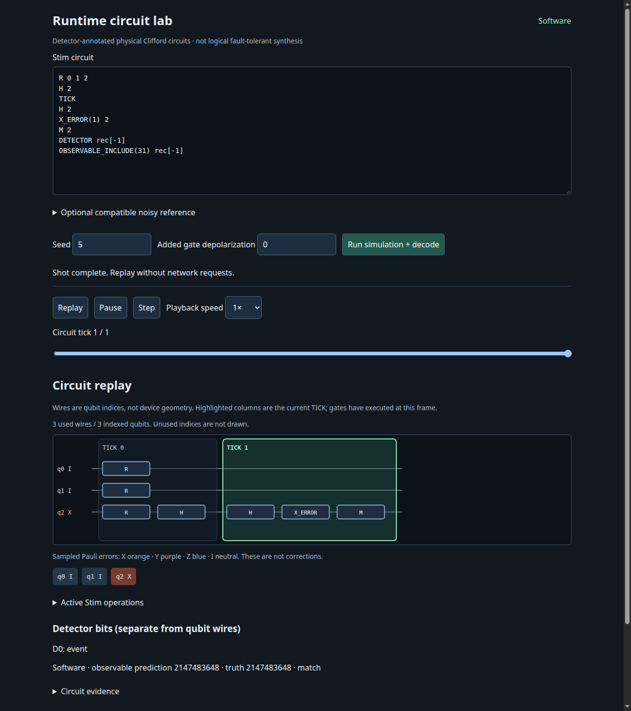
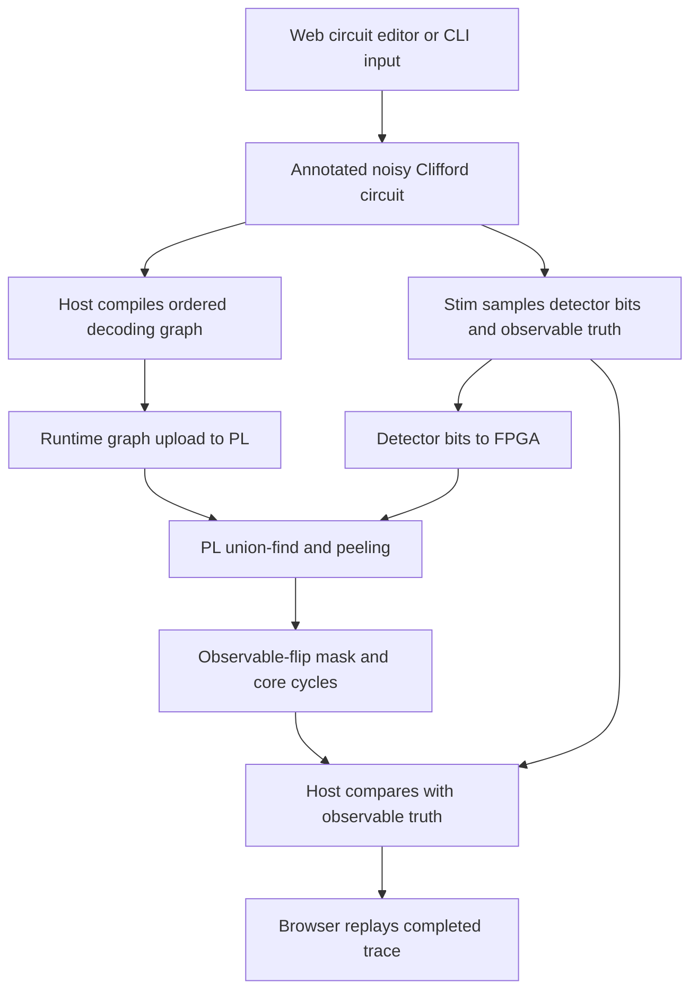

# Zybo QEC Decoder

A standalone QEC decoder project for the **Digilent Zybo Z7-10**
(`xc7z010clg400-1`), with Stim-generated inputs, FPGA decoding, and host-side
verification. This repository uses **`main`**.

## Prerequisites

### Python

Install [uv](https://docs.astral.sh/uv/getting-started/installation/), then run
these commands from the repository root:

```sh
uv venv --python 3.12 qec/.venv
uv pip install --python qec/.venv/bin/python -r qec/requirements.txt
source qec/.venv/bin/activate
mkdir -p build
```

### AMD toolchain and board

For FPGA decoding and optional RTL simulation, install Vivado/Vitis 2025.2 with
Zynq-7000 support using the [AMD installation guide](https://docs.amd.com/r/2025.2-English/ug1742-vitis-release-notes/Installing-the-Vitis-Software-Platform).
Add their bin directories to PATH, adjusting the installation paths below:

```sh
export PATH="$HOME/amd/2025.2/Vivado/bin:$HOME/amd/2025.2/Vitis/bin:$PATH"
```

Install the [Digilent board files](https://digilent.com/reference/programmable-logic/guides/install-board-files)
and AMD cable drivers for the Zybo Z7-10. The build uses board part
`digilentinc.com:zybo-z7-10:part0:1.2`. Set `QEC_BOARD_REPO` to the `board_files`
directory if it is outside Vivado's board search paths.

Connect the powered board through its PROG/UART USB port and grant your account
serial-device access. For software-only use, the Python setup is sufficient.

## Quick start: configure, run and replay in the web interface

The runtime decoder accepts detector-annotated Clifford circuits with different
physical-qubit counts, gates, checks and logical observables. The web editor takes
Stim text; the host compiles its decoding graph and uploads that graph to the
FPGA. Changing a compatible circuit does not require rebuilding the bitstream.

The current Z7-10 image has capacity for **128 detectors, 512 graph edges and
32 observable bits**, at 100 MHz. Physical-qubit count is independent of detector
count; the host parser separately bounds it for resource safety. The decoder is
unweighted union-find/peeling. Non-graphlike fault components, ambiguous observable
labels and detectorless logical faults are rejected rather than silently dropped.

The runtime image has passed RTL regressions, routed timing, an ARM firmware
build and physical FPGA checks across six different circuit graphs without
reprogramming between graphs. See [verification evidence](docs/runtime-verification.md).
The screenshot below is explicitly Software mode.

### 1. Build the runtime bitstream and firmware

```sh
vivado -mode batch -source scripts/build_runtime.tcl > build/runtime_build.log 2>&1
vitis -s vitis/runtime/build_app.py > build/runtime_firmware_build.log 2>&1
```

Vivado builds the PS7/AXI GPIO design and runtime-loadable PL decoder. Vitis builds
the ARM transport firmware against that image's XSA. Both commands must succeed.
The default output directory is `build/runtime-image` and must be fresh:

- `build/runtime-image/runtime_soc.bit`
- `build/runtime-image/runtime_soc.xsa`
- `build/runtime-image/vitis_ws/runtime_app/build/runtime_app.elf`

Review `runtime_soc_timing_summary.rpt`, `runtime_soc_utilization.rpt` and
`runtime_soc_drc.rpt` in the image directory. The build refuses public image export
if routed setup or hold timing fails. To rebuild, select a new output directory
with the [runtime build options](docs/code-walkthrough.md#scripts-build-simulate-and-load); do not overwrite an
earlier result. Skip steps 1–2 for software-only use.

### 2. Load the board

Close serial monitors and serial-backed web servers, then find the UART port:

```sh
python -m serial.tools.list_ports -v
PORT=/dev/ttyUSB1          # use the discovered UART port
```

Load the matching bitstream, firmware and XSA over JTAG:

```sh
xsct scripts/run_soc.tcl build/runtime-image/runtime_soc.bit build/runtime-image/vitis_ws/runtime_app/build/runtime_app.elf build/runtime-image/runtime_soc.xsa > build/runtime_program.log 2>&1
```

This programs the PL and restarts ARM core 0 in volatile state; power loss
requires reloading. It does not write boot flash. Check the program log for
successful programming and ARM startup. A legacy fixed-ROM image uses a different
serial protocol and cannot serve runtime graph uploads.

### 3. Open the web interface

```sh
python -m qec.surface.runtime_web --port 8766 --serial-port "$PORT"
```

Open **http://127.0.0.1:8766/**. The source label is **FPGA**. For software-only
use, omit `--serial-port "$PORT"`; the label is **Software**, and Python runs the
same unweighted graph algorithm. FPGA errors never fall back to software.

The server binds only to loopback. Opening the page does not query, program or
reset the board. No frontend build is needed. Stop it with Ctrl+C before using
the UART with another client.



This Software run uses an edited three-qubit Clifford circuit with observable
bit 31. Its prediction and simulated truth both equal 2147483648. The source
label and separate Run/Replay controls remain visible.

### 4. Define the circuit, noise and seed

Edit **Stim circuit**. It accepts supported Clifford compositions, preparation,
measurements, noise instructions, `TICK`, `DETECTOR` and `OBSERVABLE_INCLUDE`.
Qubit indices, gate order, checks and observable definitions come from your text.
The initial [phase-Bell circuit](qec/examples/runtime/phase_bell.stim) uses two
qubits and two observable bits. The [two-repetition echo](qec/examples/runtime/two_repetition_echo.stim)
uses six qubits and two observable bits; paste it into the same editor to change
the experiment. These are editable examples, not a template whitelist.

Set **Seed** and **Added gate depolarization** (0–0.75). Existing noise in the
editor is retained. Added noise follows each one/two-qubit unitary group; other
unitary Pauli-product operations receive single-qubit depolarization on their
support. It does not add measurement or reset noise; specify those in the circuit.
A rate of 0 disables only the added noise, not noise already present in the text.

For a zero-noise experiment with an empty decoding graph, expand **Optional
compatible noisy reference** and supply the same annotated experiment with noise.
The compiler checks compatibility and never invents reference noise.

Checks and observables must be deterministic without noise. Bare Clifford gates
do not define a QEC experiment: supply its encoding, checks and readout. This
frontend accepts annotated physical circuits; it does not automatically synthesize
an arbitrary logical program into a fault-tolerant implementation. Measurement
feedback and sweep-controlled operations are currently rejected.

Editing settings does not run simulation or contact the board.

### 5. Simulate and decode

Click **Run simulation + decode**. The server compiles the submitted experiment
and samples one seeded Stim shot. In FPGA mode it reads the image's capacities,
uploads the circuit's exact ordered graph and decodes that shot's detector bits.
The FPGA returns an observable-flip mask and measured core cycles. Observable
truth stays on the host and is used to evaluate the returned prediction.

A graph-load or decoding error produces an error, not a software replacement or
an old result. The graph upload happens on Run, not on circuit edits or replay.

### 6. Replay the completed run

Click **Replay**, **Pause**, or **Step**, or scrub the circuit tick. Playback
speed affects only visualization. Replay uses the completed response and sends
no simulation, graph-upload or decoder requests. Editing invalidates the result
until the next explicit Run.

Detector events and sampled Pauli frames are derived from the same simulation.
The final tick shows prediction versus true observable mask; bit i means flip
the interpretation of logical observable i. Expand circuit, graph or transport
evidence to inspect inputs and provenance. The animation is not physical quantum
feedback, and the FPGA does not return physical correction gates.

## Alternative: command-line workflow

Run an annotated circuit in software:

```sh
python -m qec.surface.runtime_run qec/examples/runtime/two_repetition_echo.stim --shots 128 --seed 123 --out build/my-runtime-software-run
```

```json
{
  "source": "Software",
  "shots": 128,
  "seed": 123,
  "qubits": 6,
  "detectors": 4,
  "observables": 2,
  "edges": 6,
  "measurements": 6,
  "ticks": 2,
  "logical_failures": 0,
  "reference_mismatches": 0,
  "graph_sha256": "26e79c182c4e5ff4999bee26f612919da88ffadd7f06ccd4f5e084529cffbbe6"
}
```

- `source`: actual decoder path, Software or FPGA.
- `shots`, `seed`: sampled batch size and random seed.
- `qubits`, `detectors`, `observables`, `edges`: physical index count and compiled
  decoding dimensions; qubits include gaps up to the highest index.
- `measurements`, `ticks`: measurement results and TICK separators, not measured
  hardware time or extraction rounds.
- `logical_failures`: predictions differing from actual Stim observable truth.
- `reference_mismatches`: returned predictions differing from the Python UF
  reference, or reference decode errors. This is separate from logical accuracy.
- `graph_sha256`: host artifact identity, not FPGA-attested cryptographic identity.

To use the loaded runtime FPGA instead, close the web server and add the UART:

```sh
python -m qec.surface.runtime_run qec/examples/runtime/two_repetition_echo.stim --shots 128 --seed 123 --port "$PORT" --out build/my-runtime-fpga-run
```

The CLI uploads the graph once, decodes the sampled batch and archives actual
predictions, truth, core cycles and serial evidence. `--out` must be new.
`--reference FILE` supplies an explicit compatible noisy reference. See the
[CLI walkthrough](docs/code-walkthrough.md#follow-one-cli-run) for archive fields and failure
behavior. Equal seeds do not imply equal shots across the CLI batch sampler and
the web's single-shot FlipSimulator call sequence.

## Data flow



Serial traffic passes through USB UART, ARM firmware and the same-FCLK AXI GPIO
mailbox. ARM transports graph/shot data; it does not decode in place of the FPGA.
The core is unweighted and can disagree with weighted PyMatching. Decoder
correctness against its own Python reference and logical accuracy against Stim
truth are measured separately.

## Source walkthroughs

Start with the [code walkthrough](docs/code-walkthrough.md). It explains the
entry points in `qec/`, `rtl/`, `scripts/` and `vitis/`, follows one decode from
Python to the FPGA, and separates the runtime path from the older fixed images.

Run `make test` with the Python environment active. It checks the software and
documentation links; the walkthrough also lists RTL and browser checks.

## Other paths

- [Legacy fixed-ROM memory quick start](docs/legacy-memory-quickstart.md): the old
  d3 Z/r3 image and its separate transport/UI, retained for reproduction.
- [Restricted logical compiler](qec/examples/README.md): the separate vetted
  memory/H/CX logical-template path. It is not the runtime physical-circuit editor
  and does not establish arbitrary logical-to-fault-tolerant synthesis.
