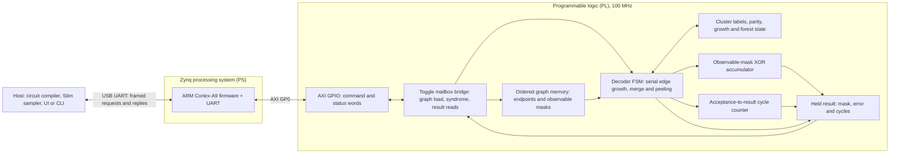

# Zybo QEC Decoder

This is an educational project to run the QEC pipeline on a relatively cheap Zybo
Z7-10 FPGA board. This project uses Stim to simulate the circuit and pass the detector
bits to the FPGA board via UART, FPGA runs the decoding and send back the prediction,
finally comparing the prediction results on the host machine.

The whole process can be controlled and visualized through a web interface, a simpler
cli-based interface is also available. Start with the [quick start](docs/quickstart.md)
for setup, building, board loading and the web interface. The
[code walkthrough](docs/code-walkthrough.md) for more implementation details.

## Replay demos

Captured from the web interface after real FPGA decodes. Both examples use seed
`20261107` and an explicitly injected X fault at tick 8. Replay shows the simulated
Pauli frame and detector bits; the FPGA predicts observable flips. The green
correction overlay is computed by the host, not returned by the FPGA.

### Z memory · one distance-3 patch

17 physical qubits, three extraction rounds, with the fault on q1.

### Encoded Bell · two distance-3 patches

34 physical qubits, with the fault on q0. The FPGA prediction matches the sampled
observable flip. The [encoded-example assumptions](qec/examples/README.md) apply.

## Workflow

1. The web interface provides a list of circuit preset, you can either chose one of
them or provide an customized physical circuit.
2. Configure the error rates and inject errors.
3. Compile the circuit, simulate and run the decoder by pressing "Simulate and decode".
4. Replay the simulation using the bottom timeline UI.

The web entry point is `python -m qec.surface.web` on port 8765. There are two modes:
- Software mode (default) runs the Python reference decoder
- FPGA mode (with `--serial-port /dev/ttyUSBx` argument) used the FPGA decoder

## FPGA architecture

PS handles transport and mailbox access; PL performs the decode. The core
processes one shot at a time using unweighted union-find growth and forest
peeling.
