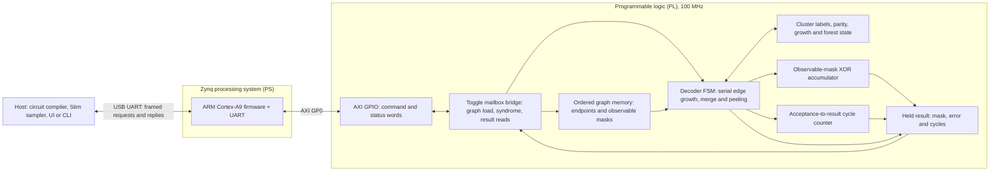

# Zybo QEC Decoder

A graph-loadable quantum error-correction decoder for the Digilent Zybo Z7-10
(`xc7z010clg400-1`). Python compiles detector-annotated Stim Clifford circuits,
simulates measurement outcomes, and sends detector bits to the FPGA. The FPGA
predicts which declared logical observables flipped. The host compares that
prediction with simulation truth and displays the completed shot.

Start with the [quick start](docs/quickstart.md) for setup, building, board loading
and the web interface. The [code walkthrough](docs/code-walkthrough.md) follows
one request through Python, ARM firmware and RTL.

## Workflow and capabilities

The web interface combines a compact paper-style lattice, a logical/input
circuit view, a physical-qubit grid and a scrub-able timeline. Use a known
surface-memory preset or submit an annotated physical circuit. Run compiles the
graph and simulates and decodes a shot; Replay uses the completed trace without
contacting the decoder. The single web entry point is `python -m qec.surface.web`
on port 8765. Software mode runs the Python reference; FPGA mode requires the
matching loaded image and a serial port, and never substitutes software on error.

The checked-in Bell and echo examples use two and six distance-3 surface-code
patches (34 and 102 physical qubits). They are fixed encoded experiments under
an explicit storage/readout noise model with ideal gates and exact gate-boundary
check results. Their logical diagrams come from tested generated mappings;
this is not an arbitrary logical-to-QEC compiler. See the
[example assumptions](qec/examples/README.md), including the ordinary-Bell/no-S
adaptation and nonlocal transversal-CX coupling assumption.

The accepted hardware design supports up to **128 detectors, 512 graph edges and
32 observable bits at 100 MHz**. These are decoder capacities, not a physical-qubit
limit. Compatible graph changes upload through the existing image without another
bitstream build. The compiler checks graph dimensions and rejects unsupported
fault signatures rather than dropping them.

## FPGA architecture

ARM handles transport and mailbox access; PL performs the decode. The core
processes one shot at a time using unweighted union-find growth and forest
peeling. Registered stages scan graph edges serially; the diagram does not imply
one parallel decoder per qubit or edge. Core cycles exclude serial transport,
graph loading and time waiting for the host to consume the result.

## Scope and evidence

Inputs must include the physical preparation, checks, detector annotations and
observable definitions. A logical view is meaningful for a known memory preset
or an explicitly supplied logical description/mapping. Supplying a logical
circuit does not prove its correspondence to the physical circuit. This project
does not automatically synthesize arbitrary logical programs into fault-tolerant
implementations.

The FPGA returns an observable-flip mask, not physical correction gates. Host
visualizations and counterfactual correction overlays are not FPGA outputs.
Completed simulated windows do not demonstrate live quantum acquisition or
adaptive quantum feedback. Unweighted decoding can disagree with weighted
matching and can fail against simulated logical truth.

The [verification record](docs/verification.md) links archived routed reports and
physical-board captures. The accepted image decoded six different graphs without
reprogramming: 1,019 predictions matched the Python reference, including 768
sampled shots. Those finite samples do not establish a zero logical-error rate.
The reorganized build and unified interface also passed separate physical-board
checks, recorded alongside the archived results.

See the [decoder design](docs/decoder-design.md) for the graph and transport
contract, and [editable examples](qec/examples/README.md) for annotated Stim inputs.
