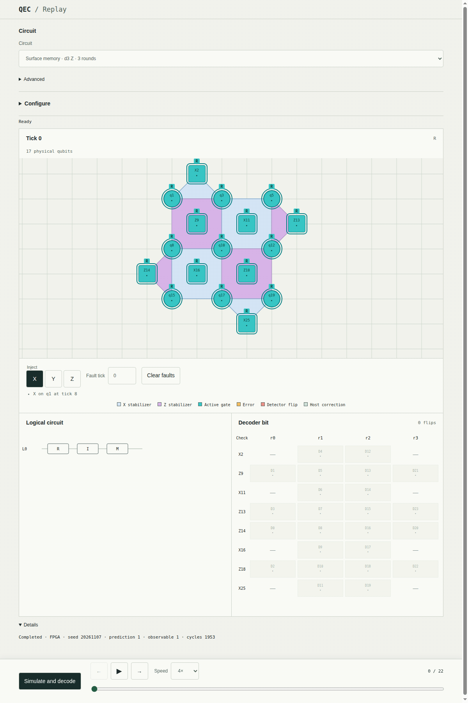
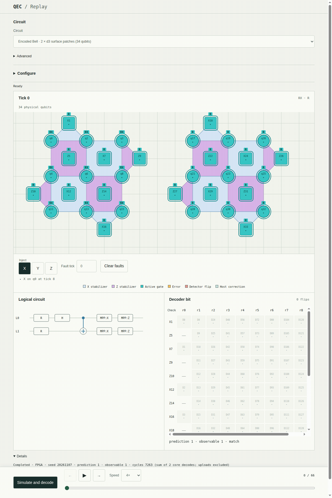
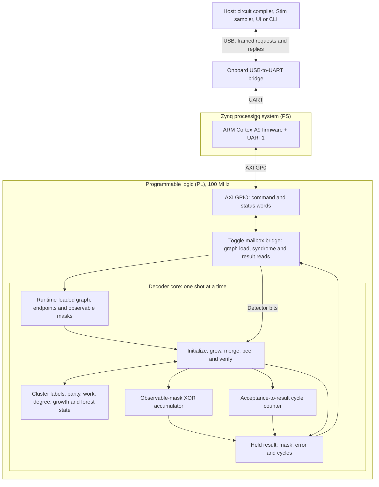

# Zybo QEC Decoder

This is an educational project that runs a QEC pipeline on a relatively cheap Zybo
Z7-10 FPGA board. It uses Stim to simulate a circuit and sends the detector bits
to the board via UART. The FPGA decodes them and returns a prediction, which the
host compares with the simulated observable flips.

The whole process can be controlled and visualized through a web interface. A simpler
CLI is also available. Start with the [quick start](docs/quickstart.md)
for setup, building, board loading and the web interface. See the
[code walkthrough](docs/code-walkthrough.md) for implementation details.

## Replay demos

Captured from the web interface after real FPGA decodes. Both examples use seed
`20261107` and an explicitly injected X fault at tick 8. Replay shows the simulated
Pauli frame and detector bits; the FPGA predicts observable flips. The green
correction overlay is computed by the host, not returned by the FPGA.

### Z memory · one distance-3 patch

17 physical qubits, three extraction rounds, with the fault on q1.

### Encoded Bell · two distance-3 patches

34 physical qubits, with the fault on q0. The FPGA prediction matches the sampled
observable flip. The [encoded-example assumptions](qec/examples/README.md) apply.

## Workflow

1. Choose a circuit preset in the web interface or provide a custom annotated
   physical circuit.
2. Configure the error rates and inject errors.
3. Press "Simulate and decode" to compile the circuit, simulate it and run the decoder.
4. Replay the simulation using the bottom timeline controls.

The web entry point is `python -m qec.surface.web` on port 8765. There are two modes:

- Software mode (default) runs the Python reference decoder.
- FPGA mode (with `--serial-port /dev/ttyUSBx`) uses the FPGA decoder.

## Benchmarks

See [accuracy results](docs/benchmark-accuracy.md) and [performance details](docs/benchmark-timing.md); the tables use three-round Z memory at p = 0.001 and 100 MHz.

All four curves in each X/Z panel were decoded on the Zybo Z7-10 in programmable
logic at 100 MHz (93,500 verified UART decode replies across 46,750 unique
syndromes; no software decoder stand-ins). Measured on-board Z-memory core
latency at p = 0.001 ([details](docs/benchmark-timing.md#on-board-d3-and-d5-comparison)):

| PL decoder / workload | Mean core latency (µs) | Nonempty / max (µs) | Full-SoC LUT / FF / BRAM36 |
| --- | ---: | ---: | ---: |
| UF, d3 Z | 1.94 | 24.43 | 9,048 / 3,195 / 1.5 |
| UF, d5 Z | 18.52 | 130.22 | 9,048 / 3,195 / 1.5 |
| Exact matching (programmable d3/d5, 4-lane BRAM), d3 Z | 8.00 | 51.10 | 3,090 / 3,247 / 18 |
| Exact matching (programmable d3/d5, 4-lane BRAM), d5 Z | 4,513.77 | 10,764.14 | 3,090 / 3,247 / 18 |
| Exact matching (fixed d3 Z, 32-lane FF), d3 Z | 0.85 | 5.12 | 11,981 / 8,126 / 1 |

UF RTL latency and modeled service capacity:

| Workload | Mean RTL latency (µs) | p95 (µs) | Modeled capacity (k jobs/s) | Max modeled FIFO wait, 3.3 µs arrivals (µs) |
| --- | ---: | ---: | ---: | ---: |
| d3 Z memory | 2.02 | 15.97 | 490.05 | 46.58 |
| d5 Z memory | 17.77 | 67.05 | 56.21 | 3,728.82 |

| Routed full-SoC resource | Usage |
| --- | ---: |
| LUTs | 9,048 |
| Flip-flops | 3,195 |
| BRAM36 tiles | 1.5 |

## FPGA architecture

The ARM firmware handles UART framing and mailbox access; PL performs the decode.
The host uploads an ordered graph at runtime, then sends detector bits for each
shot. The default image supports up to 128 detectors, 512 edges and 32 observable
bits. Compatible graphs can be replaced without rebuilding the FPGA image.

The core processes one shot at a time using unweighted union-find growth and forest
peeling. A finite-state machine (FSM) controls the steps, processing edges serially
and storing intermediate values in registers between clock cycles. Selected edge
masks are XORed into the observable prediction. A valid all-zero syndrome skips
work-state initialization and completes in one counted clock; during peeling,
nonforest and already-removed edges skip the endpoint/work-read stages. The core
holds its result until the mailbox bridge accepts it.
