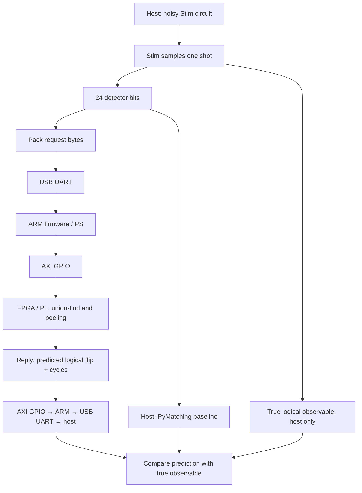

# Zybo QEC Decoder

A standalone QEC decoder project for the **Digilent Zybo Z7-10**
(`xc7z010clg400-1`), with Stim-generated inputs, FPGA decoding, and host-side
verification. This repository uses **`main`**.

## Prerequisites

### Python

Install [uv](https://docs.astral.sh/uv/getting-started/installation/), then run
these commands from the repository root:

```sh
uv venv --python 3.12 qec/.venv
uv pip install --python qec/.venv/bin/python -r qec/requirements.txt
source qec/.venv/bin/activate
mkdir -p build
```

### AMD toolchain and board

For RTL simulation and the board example, install Vivado/Vitis 2025.2 with
Zynq-7000 support using the [AMD installation guide](https://docs.amd.com/r/2025.2-English/ug1742-vitis-release-notes/Installing-the-Vitis-Software-Platform).
Add their bin directories to PATH, adjusting the installation paths below:

```sh
export PATH="$HOME/amd/2025.2/Vivado/bin:$HOME/amd/2025.2/Vitis/bin:$PATH"
```

Install the [Digilent board files](https://digilent.com/reference/programmable-logic/guides/install-board-files)
and AMD cable drivers for the Zybo Z7-10. The build uses board part
`digilentinc.com:zybo-z7-10:part0:1.2`. Set `QEC_BOARD_REPO` to the `board_files`
directory if it is outside Vivado's board search paths.

Connect the powered board through its PROG/UART USB port and grant your account
serial-device access.

## Quick start: manually decode a complete window

Run all commands from the repository root. The example uses a distance-3
surface code with three rounds of Z memory.

## 1. Workflow



The circuit is simulated on the PC, its detector bits go to the FPGA board. Stim is used as a circuit simulator,
**PyMatching** decodes the same detector bits separately. The FPGA runs
an unweighted union-find/peeling algorithm, so it can disagree with PyMatching.
For implementation correctness we compare the FPGA with the Python version of its own algorithm.

A detector bit records a measurement-parity change relative to the circuit's
expected behavior. A complete set for one shot is the decoder input; bit i goes
in integer bit i (little-endian packing). The decoder groups detection events
using the graph, then selects correction edges by peeling a spanning forest.
The XOR of their logical-observable labels is the predicted logical flip.

Stim supplies both the detector input and the true logical flip for evaluation.
**The true flip is not sent to the FPGA.** A prediction of 1 means invert the
logical measurement interpretation. The sample does not connect to a quantum processor, execute physical
corrections, or run continuous feedback. It processes completed simulated shots.

## 2. Run the software example

The [example](qec/surface/example.py) samples a noisy surface-code shot, decodes its detector bits with Python union-find and PyMatching, and prints both predictions alongside the simulated logical observable.

```sh
python -m qec.surface.example --seed 20261107 --shots 256
```

```json
{
  "shot": 11,
  "detector_indices": [
    11
  ],
  "syndrome": 2048,
  "observable": 0,
  "prediction": 0,
  "pymatching": 0,
  "correction_edges": [
    47
  ],
  "residual": 0,
  "logical_error": false,
  "tx_hex": "c3 00 03 00 08 00 c8"
}
```

- `shot`: zero-based index of the selected shot.
- `detector_indices`: indices of the detectors that fired.
- `syndrome`: detector bits packed into an integer; bit i stores detector i.
- `observable`: simulated logical flip, where 0 means no flip and 1 means a flip.
- `prediction`: logical-flip prediction from the Python union-find decoder.
- `pymatching`: logical-flip prediction from PyMatching.
- `correction_edges`: graph-edge indices selected by the Python decoder.
- `residual`: detector parity remaining after the correction; 0 means all events cancel.
- `logical_error`: whether `prediction` differs from `observable`.
- `tx_hex`: request bytes in hexadecimal.

`--seed` makes sampling reproducible; omit it for fresh randomness. `--shots`
sets the sampled batch size (default: 256); each run decodes one shot from that
batch. `--noise` sets the error probability at each gate, reset and measurement
noise location (default: 0.001, range: 0–0.75); use 0 to disable noise. Add
`--circuit` to print the full Stim circuit and its noise instructions.

## 3. Simulate the FPGA decoder

```sh
python qec/surface/sim.py --distance 3 --basis z --shots 256
```

This optional step compares RTL predictions with the Python reference and checks
cycle counting, backpressure and reset recovery in Vivado Simulator.
Adjust `--distance` (odd values of 3 or greater), `--basis` (`x` or `z`) and
`--shots` to change the code distance, memory basis and number of sampled shots.
The board example below uses distance 3 and Z memory.

## 4. Build the bitstream and firmware

```sh
vivado -mode batch -source scripts/build_soc.tcl -tclargs top_surface_soc > build/surface_build.log 2>&1
vitis -s vitis/surface/build_app.py > build/surface_firmware_build.log 2>&1
```

Vivado builds the PS7/AXI GPIO design and PL decoder. Vitis builds the ARM UART
transport firmware. Check that both commands succeed and produce:

```text
build/surface_soc.bit
build/surface_soc.xsa
build/vitis_ws/surface_app/build/surface_app.elf
```

Review the build logs and `build/top_surface_soc_timing_summary.rpt` before
loading the board.

## 5. Load the board

Close any serial monitor before loading the board.

Find the UART port:

```sh
python -m serial.tools.list_ports -v
PORT=/dev/ttyUSB1          # use the discovered UART port
```

The following command programs the FPGA and restarts ARM core 0. It loads volatile
state over JTAG; power loss requires reloading.

```sh
xsct scripts/run_soc.tcl build/surface_soc.bit build/vitis_ws/surface_app/build/surface_app.elf build/surface_soc.xsa > build/surface_program.log 2>&1
```

Check `build/surface_program.log` for successful FPGA programming and ARM startup.

## 6. Run the board example

```sh
python -m qec.surface.example --seed 20261107 --shots 256 --port "$PORT"
```

```json
{
  "shot": 11,
  "detector_indices": [
    11
  ],
  "syndrome": 2048,
  "observable": 0,
  "prediction": 0,
  "pymatching": 0,
  "correction_edges": [
    47
  ],
  "residual": 0,
  "logical_error": false,
  "tx_hex": "c3 00 03 00 08 00 c8",
  "rx_hex": "3c 00 00 00 a9 03 00 00 96",
  "board_prediction": 0,
  "pl_cycles": 937
}
```

The board run adds:

- `rx_hex`: reply bytes received from the board, in hexadecimal.
- `board_prediction`: logical-flip prediction returned by the FPGA.
- `pl_cycles`: decoder clock cycles measured on the FPGA at 100 MHz.

The example regenerates the shot from section 2 and sends its detector bits to
the loaded surface decoder. It prints the reply, checks the prediction against
the Python reference and checks that the cycle count is positive.
