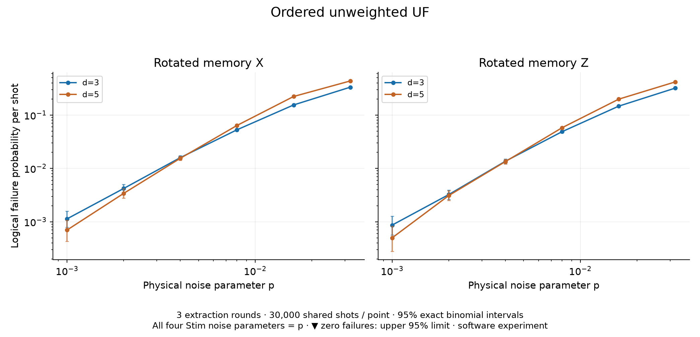
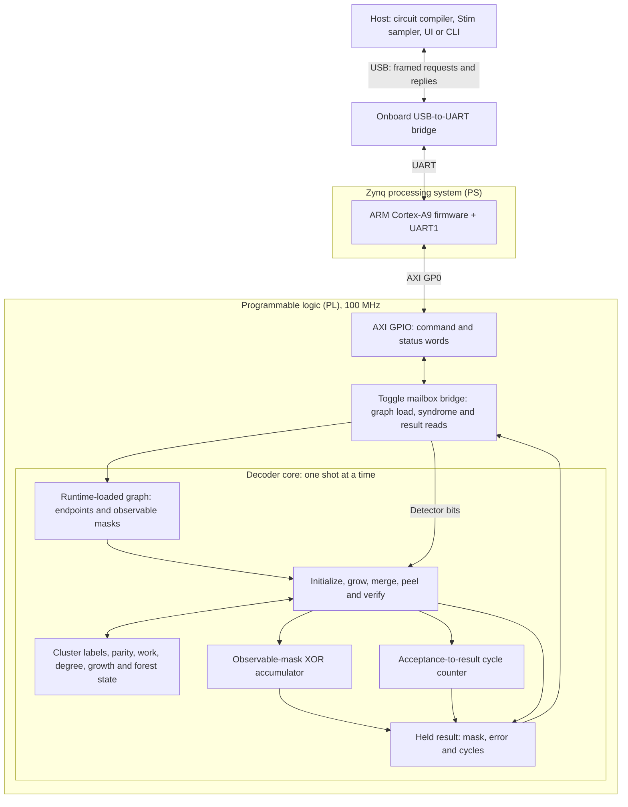

# Zybo QEC Decoder

This project runs a quantum error correction (QEC) decoding pipeline on a
Digilent Zybo Z7-10 FPGA board (`xc7z010clg400-1`). On the host computer,
Stim simulates a noisy quantum circuit and sends the resulting detector bits
over UART to the board. The FPGA decodes those bits in programmable logic and
returns a predicted logical observable flip, which the host compares against
the true simulated outcome.

You can drive the pipeline and inspect every step in a local web interface, or
run batches from the command line. Start with the
[quick start](docs/quickstart.md) to set up the tools, build the image, load
the board, and launch the UI. See the
[code walkthrough](docs/code-walkthrough.md) for a tour of the source tree, or
[decoder design](docs/decoder-design.md) for the algorithm and hardware
protocols.

## Replay demos

Both clips below were recorded from the web interface after real FPGA decodes.
Each run uses seed `20261107` and a manually injected X fault at tick 8. The
replay animates the simulated Pauli errors and detector triggers; the FPGA
itself only receives the detector bits and returns a logical flip prediction.
The green correction overlay at the end is computed on the host to help
visualize a matching physical recovery.

### Z memory (one distance-3 patch)

17 physical qubits (9 data, 8 ancillas) over three stabilizer rounds, with an X
fault injected on `q1`.

### Encoded Bell (two distance-3 patches)

34 physical qubits across two patches, with an X fault injected on `q0`. The
FPGA prediction matches the simulated observable flip. See
[encoded circuit examples](qec/examples/README.md) for the circuit and noise
model details.

## How it works

1. Pick a built-in circuit preset in the web interface, or paste a custom
   detector-annotated Stim circuit under **Advanced**.
2. Adjust noise rates and the random seed under **Configure**, or click
   physical qubits to inject specific Pauli faults.
3. Click **Simulate and decode** to compile the circuit's decoding graph,
   sample one shot with Stim, and decode the detector bits.
4. Step through or play back the shot using the timeline bar at the bottom.

Launch the web interface with `python -m qec.surface.web` (port `8765` by
default):

- **Software mode** (default) decodes on the host with the Python union-find
  reference decoder.
- **FPGA mode** (`--serial-port /dev/ttyUSBx`) uploads the decoding graph to
  the Zybo board and runs decoding in hardware.

## Benchmarks

Full methodology and hardware comparisons live in
[accuracy results](docs/benchmark-accuracy.md) and
[decoder performance](docs/benchmark-timing.md). The tables below summarize
the default runtime union-find (UF) core on three-round rotated Z memory at
`p = 0.001` and 100 MHz.

| Workload | Mean RTL latency (µs) | p95 (µs) | Modeled capacity (k jobs/s) | Max modeled FIFO wait, 3.3 µs arrivals (µs) |
| --- | ---: | ---: | ---: | ---: |
| d3 Z memory | 2.02 | 15.97 | 490.05 | 46.58 |
| d5 Z memory | 17.77 | 67.05 | 56.21 | 3,728.82 |

| Routed full-SoC resource | Usage |
| --- | ---: |
| LUTs | 9,048 |
| Flip-flops | 3,195 |
| BRAM36 tiles | 1.5 |

## FPGA architecture

The Zynq chip splits the work between its ARM processor (PS) and programmable
logic (PL):

- **ARM firmware (PS)** handles framed UART packets from the host and drives a
  32-bit AXI GPIO mailbox into programmable logic.
- **Decoder core (PL)** stores an uploaded decoding graph and decodes one
  syndrome shot at a time. The default image holds up to 128 detectors, 512
  edges, and 32 logical observable bits, so you can switch between compatible
  circuits at runtime without rebuilding the bitstream.

Inside the core, a finite-state machine (FSM) runs unweighted union-find
growth followed by forest peeling. It scans edges one at a time, keeping
intermediate values in registers between clock cycles, and XORs the observable
masks of selected edges to form the final prediction. Two shortcuts save
cycles: an all-zero syndrome finishes in a single counted clock without
clearing work arrays, and peeling skips nonforest or already-removed edges in
one clock. Once done, the core holds the prediction, error flag, and cycle
count until the mailbox bridge reads them out.
