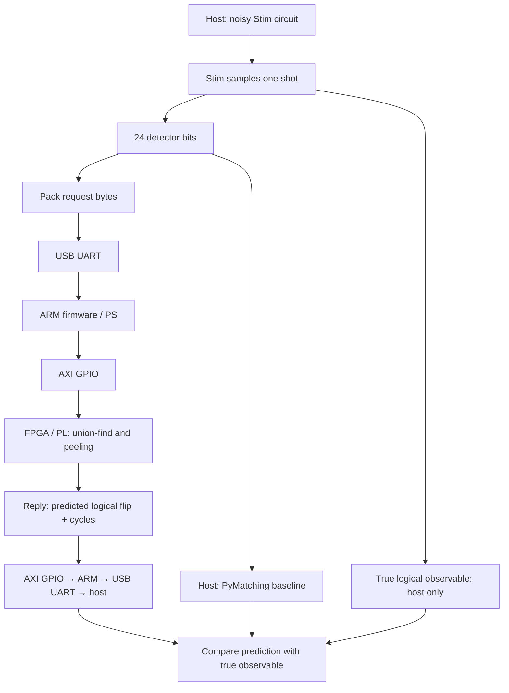

# Zybo QEC Decoder

A standalone QEC decoder project for the **Digilent Zybo Z7-10**
(`xc7z010clg400-1`), with Stim-generated inputs, FPGA decoding, and host-side
verification. This repository uses **`main`**.

## Quick start: manually decode a complete window

Run all commands from the **repository root**. This guide uses the algorithmic
**surface-code sample** first (distance 3, three rounds, Z memory), then shows
how to switch to the smaller repetition-code LUT sample.

## 1. Workflow



The circuit is simulated on the PC, its detector bits go to the FPGA board. Stim is used as a circuit simulator,
**PyMatching** decodes the same detector bits separately. The FPGA runs
an unweighted union-find/peeling algorithm, so it can disagree with PyMatching.
For implementation correctness we compare the FPGA with the Python version of its own algorithm.

A detector bit records a measurement-parity change relative to the circuit's
expected behavior. A complete set for one shot is the decoder input; bit i goes
in integer bit i (little-endian packing). The decoder groups detection events
using the graph, then selects correction edges by peeling a spanning forest.
The XOR of their logical-observable labels is the predicted logical flip.

Stim supplies both the detector input and the true logical flip for evaluation.
**The true flip is not sent to the FPGA.** A prediction of 1 means invert the
logical measurement interpretation. The sample does not connect to a quantum processor, execute physical
corrections, or run continuous feedback. It processes completed simulated shots.

## 2. Prepare Python

```sh
uv venv --python 3.12 qec/.venv
uv pip install --python qec/.venv/bin/python -r qec/requirements.txt
source qec/.venv/bin/activate
mkdir -p build
python -m pytest qec/tests -q
```

Python requirements include Stim, PyMatching, NumPy, pyserial and pytest.

## 3. Manually inspect one noisy shot in software

The [example](qec/surface/example.py) samples a noisy surface-code shot, decodes its detector bits with Python union-find and PyMatching, and prints both predictions alongside the simulated logical observable.

```sh
python -m qec.surface.example
```

```json
{
  "shot": 11,
  "detector_indices": [
    11
  ],
  "syndrome": 2048,
  "observable": 0,
  "prediction": 0,
  "pymatching": 0,
  "correction_edges": [
    47
  ],
  "residual": 0,
  "logical_error": false,
  "tx_hex": "c3 00 03 00 08 00 c8"
}
```

Add `--circuit` to print the full Stim circuit and its noise instructions.

## 4. Simulate the FPGA decoder

Install AMD Vivado/Vitis 2025.2 with Zynq-7000 support. Add their bin directories
to PATH, adjusting the installation paths below:

```sh
export PATH="$HOME/amd/2025.2/Vivado/bin:$HOME/amd/2025.2/Vitis/bin:$PATH"
```

Run the decoder tests, then the AXI GPIO bridge test:

```sh
# Simulate distance-3 Z memory with 256 Stim shots; generate the bridge test vectors.
python qec/surface/sim.py --distance 3 --basis z --shots 256 > build/surface_sim_d3.log 2>&1

# Simulate distance-5 Z memory to test the decoder with a larger graph.
python qec/surface/sim.py --distance 5 --basis z --shots 128 > build/surface_sim_d5.log 2>&1

# Simulate distance-3 X memory to test the X-basis graph.
python qec/surface/sim.py --distance 3 --basis x --shots 128 > build/surface_sim_x.log 2>&1

# Compile the decoder, AXI GPIO bridge and bridge testbench.
xvlog --sv rtl/common/surface_decoder.sv rtl/common/surface_ps_bridge.sv qec/surface/tb_bridge.sv

# Elaborate the testbench into a runnable snapshot named surface_bridge.
xelab tb_surface_bridge -s surface_bridge

# Run the bridge simulation and save its output.
xsim surface_bridge -runall > build/surface_bridge_sim.log 2>&1

# Check all four logs for PASS markers and HDL fatal errors.
python scripts/check_sim_logs.py build/surface_sim_d3.log build/surface_sim_d5.log build/surface_sim_x.log build/surface_bridge_sim.log
```

The core tests compare RTL predictions with the Python reference and check cycle
counts, backpressure and reset. The bridge test checks request and result transfer
through the GPIO interface. Keep the d3 Z run at 256 shots: it generates the
423-case vector file used by the bridge test.

Each core log should contain `PASS algorithmic surface`; the bridge log should
contain `PASS surface AXI GPIO bridge`. The log checker rejects missing PASS
markers and HDL fatal errors.

## 5. Build the bitstream and firmware

Install the Digilent Zybo Z7-10 board files. The build uses board part
`digilentinc.com:zybo-z7-10:part0:1.2`. Set `QEC_BOARD_REPO` to the `board_files`
directory if it is outside Vivado's board search paths.

```sh
vivado -mode batch -source scripts/build_soc.tcl -tclargs top_surface_soc > build/surface_build.log 2>&1
vitis -s vitis/surface/build_app.py > build/surface_firmware_build.log 2>&1
```

Vivado builds the PS7/AXI GPIO design and PL decoder. Vitis builds the ARM UART
transport firmware. Check that both commands succeed and produce:

```text
build/surface_soc.bit
build/surface_soc.xsa
build/vitis_ws/surface_app/build/surface_app.elf
```

Review the build logs and `build/top_surface_soc_timing_summary.rpt` before
loading the board.

## 6. Load the board

Power the Zybo Z7-10 and connect its PROG/UART USB port. Install AMD cable drivers
and grant your account serial-device access. Close any serial monitor.

Find the UART port:

```sh
python -m serial.tools.list_ports -v
PORT=/dev/ttyUSB1          # use the discovered UART port
BOARD_ID=YOUR_BOARD_SERIAL
```

The following command programs the FPGA and restarts ARM core 0. It loads volatile
state over JTAG; power loss requires reloading.

```sh
xsct scripts/run_soc.tcl build/surface_soc.bit build/vitis_ws/surface_app/build/surface_app.elf build/surface_soc.xsa > build/surface_program.log 2>&1
vivado -mode batch -source scripts/qec_readback.tcl > build/surface_readback.log 2>&1
```

Check the program log for success and the configuration-status log for
`DONE=1`, `INIT_B=1` and `CRC_ERROR=0`.

## 7. Send one shot to the FPGA

```sh
python -m qec.surface.example --port "$PORT"
```

The example regenerates the shot from section 3 and sends its detector bits to
the loaded surface decoder. It prints the reply, checks the prediction against
the Python reference and checks that the cycle count is positive.

## 8. Capture a complete experiment

After completing sections 4–7, choose a fresh output directory and run:

```sh
python qec/surface/host.py --port "$PORT" --board-id "$BOARD_ID" --shots 4096 --noise .001 --seed 20261107 --out build/surface-run
```

The runner tests diagnostic detector patterns, decodes 4096 Stim shots, checks
malformed-packet recovery and resets the PL decoder. `--board-id` labels the
archive with your board's serial.

Inspect `build/surface-run/summary.json`:

- `uf_mismatches`: FPGA predictions that differ from the Python reference;
  this count should be zero.
- `logical_errors`: FPGA predictions that differ from Stim's observable.
- `pymatching_logical_errors`: PyMatching predictions that differ from Stim's
  observable.
- `cycles_min/median/max`: PL decoder cycle counts.
- `host_stim_ns_median`: host serial round-trip time for Stim shots.

`transactions.csv` contains detector inputs, predictions, observables, cycle
counts and raw frames. Use its `kind=stim` rows for logical-error statistics.

The runner copies the simulation, build, program and readback logs, timing and
utilization reports, bitstream, XSA and ELF into the output directory. It also
archives the circuit and Git HEAD and writes file hashes to `manifest.json`.
Keep the prerequisite logs and artifacts from the same build, and commit source
changes before capture. Missing artifacts cause archiving to fail.

## 9. Run the repetition-code sample

For a software run:

```sh
python qec/host.py --mode loopback --shots 20000 --seed 90210
```

For a board run, build and load the repetition bitstream and firmware:

```sh
vivado -mode batch -source scripts/build_soc.tcl -tclargs top_qec_soc > build/qec_soc_build.log 2>&1
vitis -s vitis/qec/build_app.py > build/qec_firmware_build.log 2>&1
xsct scripts/run_soc.tcl build/qec_soc.bit build/vitis_ws/qec_app/build/qec_app.elf build/qec_soc.xsa > build/qec_program.log 2>&1
vivado -mode batch -source scripts/qec_readback.tcl > build/qec_readback.log 2>&1
python qec/hardware_run.py --port "$PORT" --board-id "$BOARD_ID" --shots 4096 --noise .001 --seed 20261105 --out build/repetition-run
```

Apply the build and configuration checks from sections 5–6 before running the
host command. This decoder packs eight detector bits into one byte and reads
its prediction from `qec/lut.mem`. The runner checks all 256 inputs, then samples
Stim shots and tests packet recovery. Sampled accuracy is in `summary.json` under
`stim`.
