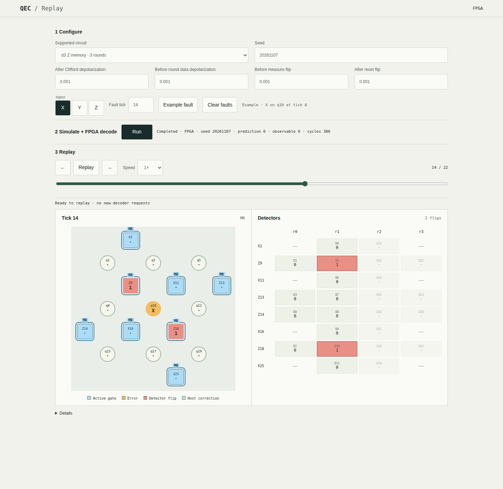
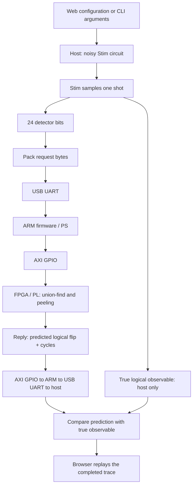

# Zybo QEC Decoder

A standalone QEC decoder project for the **Digilent Zybo Z7-10**
(`xc7z010clg400-1`), with Stim-generated inputs, FPGA decoding, and host-side
verification. This repository uses **`main`**.

## Prerequisites

### Python

Install [uv](https://docs.astral.sh/uv/getting-started/installation/), then run
these commands from the repository root:

```sh
uv venv --python 3.12 qec/.venv
uv pip install --python qec/.venv/bin/python -r qec/requirements.txt
source qec/.venv/bin/activate
mkdir -p build
```

### AMD toolchain and board

For FPGA decoding and optional RTL simulation, install Vivado/Vitis 2025.2 with
Zynq-7000 support using the [AMD installation guide](https://docs.amd.com/r/2025.2-English/ug1742-vitis-release-notes/Installing-the-Vitis-Software-Platform).
Add their bin directories to PATH, adjusting the installation paths below:

```sh
export PATH="$HOME/amd/2025.2/Vivado/bin:$HOME/amd/2025.2/Vitis/bin:$PATH"
```

Install the [Digilent board files](https://digilent.com/reference/programmable-logic/guides/install-board-files)
and AMD cable drivers for the Zybo Z7-10. The build uses board part
`digilentinc.com:zybo-z7-10:part0:1.2`. Set `QEC_BOARD_REPO` to the `board_files`
directory if it is outside Vivado's board search paths.

Connect the powered board through its PROG/UART USB port and grant your account
serial-device access. For software-only use, the Python setup is sufficient.

## Quick start: configure, run and replay in the web interface

Run all commands from the repository root. The web interface supports the
surface-code Z-memory circuit at distance 3 with three extraction rounds,
matching the board image below. You can set its four noise probabilities,
random seed and timed Pauli faults. Changing the circuit's gates, distance or
basis requires a compatible decoder graph and board image; the web interface
does not compile arbitrary circuits.

### 1. Build the bitstream and firmware

```sh
vivado -mode batch -source scripts/build_soc.tcl -tclargs top_surface_soc > build/surface_build.log 2>&1
vitis -s vitis/surface/build_app.py > build/surface_firmware_build.log 2>&1
```

Vivado builds the PS7/AXI GPIO design and PL decoder. Vitis builds the ARM UART
transport firmware. Check that both commands succeed and produce:

- `build/surface_soc.bit`
- `build/surface_soc.xsa`
- `build/vitis_ws/surface_app/build/surface_app.elf`

Review the build logs and `build/top_surface_soc_timing_summary.rpt` before
loading the board. Skip steps 1–2 for software-only use.

### 2. Load the board

Close any serial monitor or serial-backed web server, then find the UART port:

```sh
python -m serial.tools.list_ports -v
PORT=/dev/ttyUSB1          # use the discovered UART port
```

The following command programs the FPGA and restarts ARM core 0. It loads volatile
state over JTAG; power loss requires reloading.

```sh
xsct scripts/run_soc.tcl build/surface_soc.bit build/vitis_ws/surface_app/build/surface_app.elf build/surface_soc.xsa > build/surface_program.log 2>&1
```

Check `build/surface_program.log` for successful FPGA programming and ARM startup.

### 3. Open the web interface

```sh
python -m qec.surface.web --port 8765 --serial-port "$PORT"
```

Open **http://127.0.0.1:8765/**. The page identifies the decoder source as
**FPGA**. For software-only use, omit `--serial-port "$PORT"`; the source is
**Simulated**, and the server uses the Python union-find decoder instead.

The server binds only to loopback and does not program or reset the board. No
frontend build is needed. Stop it with Ctrl+C before using the UART elsewhere.



The screenshot shows seed 20261107, all four noise rates at 0.001, and the
explicit X q10 fault at tick 8. The FPGA returned prediction 0 in 386 cycles;
replay is paused at tick 14, where detectors D5 and D10 have fired.

### 4. Configure the circuit and noise

In **Configure**, select the supported circuit and set the random seed and
noise probabilities (0–0.75 each):

- Gate depolarization: errors after Clifford gates.
- Round data depolarization: data-qubit errors before each extraction round.
- Measurement flip: errors before measurement.
- Reset flip: errors after reset.

Set all four to 0 to disable random noise. You can also select a fault tick and
X, Y or Z, then click data qubits to add deterministic faults. **Example fault**
selects X on q10 at tick 8; **Clear faults** removes manually selected faults,
not the random noise settings. Editing controls does not run a simulation or
contact the board.

### 5. Simulate and decode

Click **Run** under **Simulate + FPGA decode**. The Python server runs one seeded noisy Stim
shot and sends its 24 detector bits to the loaded FPGA. It displays the returned
logical-flip prediction and measured decoder cycles alongside the simulated
logical observable. The true observable stays on the host.

In software-only mode, the run step reads **Simulate + software decode**. FPGA
serial or protocol failures appear as errors without software fallback. Noise
settings change the sampled circuit; they do not rebuild the FPGA's fixed graph.

### 6. Replay the completed run

Click **Replay** to animate the completed trace. Pause, step forward or backward,
or scrub circuit ticks at any time. Playback speed affects only the animation.
Replay does not resimulate the circuit or send another FPGA request. Changing
settings invalidates the result until you click the simulation/decoding button
again.

Detector flips appear at their measurement boundaries. **Details** contains the
Stim circuit and decoder evidence. The FPGA supplies a logical prediction and
measured cycles, not physical gates or graph edges. Correction overlays and
counterfactual comparisons are host-derived; the animation does not execute
physical corrections or provide live quantum feedback. A cleared syndrome alone
does not establish logical recovery.

## Alternative: command-line workflow

The [example](qec/surface/example.py) samples a noisy surface-code shot, decodes
its detector bits with Python union-find and PyMatching, and prints both
predictions alongside the simulated logical observable.

### Run the software example

```sh
python -m qec.surface.example --seed 20261107 --shots 256
```

```json
{
  "shot": 11,
  "detector_indices": [11],
  "syndrome": 2048,
  "observable": 0,
  "prediction": 0,
  "pymatching": 0,
  "correction_edges": [47],
  "residual": 0,
  "logical_error": false,
  "tx_hex": "c3 00 03 00 08 00 c8"
}
```

- `shot`: zero-based index of the selected shot.
- `detector_indices`: indices of the detectors that fired.
- `syndrome`: detector bits packed into an integer; bit i stores detector i.
- `observable`: simulated logical flip, where 0 means no flip and 1 means a flip.
- `prediction`: logical-flip prediction from the Python union-find decoder.
- `pymatching`: logical-flip prediction from PyMatching.
- `correction_edges`: graph-edge indices selected by the Python decoder.
- `residual`: detector parity remaining after the correction; 0 means all events cancel.
- `logical_error`: whether `prediction` differs from `observable`.
- `tx_hex`: request bytes in hexadecimal.

`--seed` makes sampling reproducible; omit it for fresh randomness. `--shots`
sets the sampled batch size (default: 256); each run decodes one shot from that
batch. `--noise` sets the error probability at each gate, reset and measurement
noise location (default: 0.001, range: 0–0.75); use 0 to disable noise. Add
`--circuit` to print the full Stim circuit and its noise instructions. The CLI
selects a shot from a batch; the web interface runs one shot, so an equal seed
does not imply identical results across these two sampling procedures.

### Decode on the board

Build and load the board using quick-start steps 1–2, then run:

```sh
python -m qec.surface.example --seed 20261107 --shots 256 --port "$PORT"
```

The documented board example returned these additional fields:

```json
{
  "rx_hex": "3c 00 00 00 a9 03 00 00 96",
  "board_prediction": 0,
  "pl_cycles": 937
}
```

- `rx_hex`: reply bytes received from the board, in hexadecimal.
- `board_prediction`: logical-flip prediction returned by the FPGA.
- `pl_cycles`: decoder clock cycles measured on the FPGA at 100 MHz.

The example sends the same selected shot's detector bits, checks the prediction
against the Python reference and checks that the cycle count is positive. Close
the web server before running another serial client.

### Optional: verify the RTL decoder

```sh
python qec/surface/sim.py --distance 3 --basis z --shots 256
```

This compares RTL predictions with the Python reference and checks cycle
counting, backpressure and reset recovery in Vivado Simulator. Adjust
`--distance` (odd values of 3 or greater), `--basis` (`x` or `z`) and `--shots`
to change the simulated workload. This check is not a prerequisite for the web
or CLI board example; those use distance 3 and Z memory.

## Data flow



A detector bit records a measurement-parity change relative to the circuit's
expected behavior. A complete set for one shot is the decoder input.
**The true logical flip is not sent to the FPGA.** A prediction of 1 means invert
the logical measurement interpretation. The system processes completed simulated
shots; it does not connect to a quantum processor.

The FPGA runs unweighted union-find/peeling and can disagree with the CLI's
PyMatching baseline. For implementation correctness, compare the FPGA with the
Python version of its own algorithm.

## Source walkthroughs

Every maintained source file has a Markdown walkthrough beside it, using the same
basename: for example, [`qec_decoder.sv`](rtl/common/qec_decoder.sv) and
[`qec_decoder.md`](rtl/common/qec_decoder.md). Each walkthrough explains the
file's interfaces, control flow, invariants and verification commands.

Start with the [web server](qec/surface/web.md),
[surface decoder](rtl/common/surface_decoder.md),
[PS/PL mailbox](rtl/common/surface_ps_bridge.md),
[ARM firmware](vitis/surface/src/main.md), or
[host transport](qec/surface/host.md). Build entry points are covered in the
[Makefile guide](Makefile.md) and [SoC build guide](scripts/build_soc.md).

Source uses four-space indentation (Make recipes retain required tabs), expanded
control flow and comments for protocol, state-machine and timing assumptions.
Keep a source's sibling walkthrough current when changing it. `make test` checks
that every maintained source has one; archived results and fixture snapshots are
excluded.

## Restricted logical compiler

The separate [compiler CLI](qec/surface/compile.py) supports only one-qubit
memory, a single temporal H, or a single lattice-surgery CX, in X/Z basis at
code distance 3 or 5. It explicitly rejects S, T, adaptive controls and all
unvalidated compositions; this is **not arbitrary Clifford compilation**.

Install its pinned optional dependency in a separate Python 3.12 environment:

```sh
uv venv --python 3.12 build/compiler-env
uv pip install --python build/compiler-env/bin/python -r qec/requirements-compiler.txt
source build/compiler-env/bin/activate
python -m qec.surface.compile qec/examples/logical_h.json --basis z --distance 3 --noise 0.001 --shots 256 --seed 123 --out build/logical-h
```

This verified H run produced 56 detectors, 208 edges and one observable;
UF/MWPM logical failures were 3/0 on the same 256 sampled shots, with zero
residual syndromes. The new output directory contains annotated Stim circuits,
DEMs, a loss-checked graph, per-shot evidence, a hash/version manifest and a
single-observable core ROM. CX preserves both observable bits in software/JSON
and emits no one-bit ROM. See the [input and artifact contract](qec/examples/README.md)
for all three example inputs, zero-noise reference handling and reproduction.

The compiler rejects `--port` before opening serial: H requires a matching
bitstream and firmware; CX also needs wider RTL/protocol support. It does not
program or reset the board. The existing `qec.surface.example` remains unchanged.
