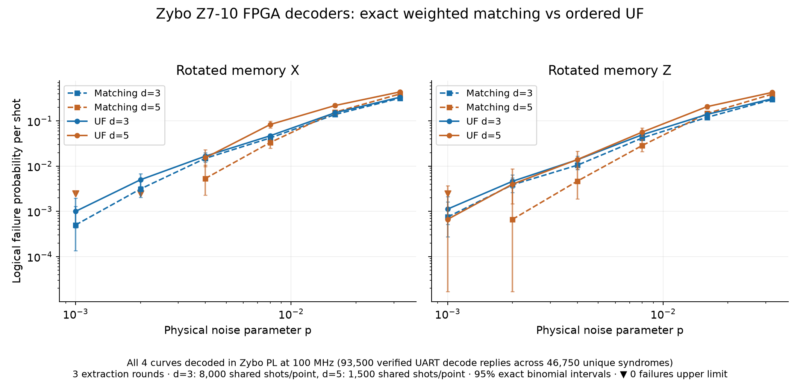

# Logical accuracy benchmark



All four curves in each X/Z panel (`Matching d=3`, `Matching d=5`, `UF d=3`, `UF d=5`) come from real Zybo Z7-10 programmable-logic execution at 100 MHz: the maintained runtime-UF image and the programmable parity-frontier exact matching image (`fpga/experimental/frontier/`) each decoded every distinct syndrome across all 24 circuit/noise points over UART (`93,500` verified decode replies total). Stim samples noisy circuits and observable truth on the host; PyMatching is used only offline to extract exact binary64 edge weights for the uploaded parity-DP programs.

## On-board 4-curve FPGA results

The board sweep covers `p = 0.001, 0.002, 0.004, 0.008, 0.016, 0.032` for rotated X and Z memories at distances 3 (`8,000` shared shots/point) and 5 (`1,500` shared shots/point), three extraction rounds, seeds `20261120..20261143`. Across the 24 points there are `114,000` shared simulated shots and `46,750` unique detector syndromes; both PL images decoded all `46,750` unique syndromes with zero hardware errors, exact IEEE CRC32 program readback on matching, and 100% prediction agreement with independent exact references. Because both PL decoders are deterministic functions of the loaded graph/program and syndrome, mapping verified board predictions onto the `114,000` truth-labeled shots is exact; raw transaction count (`93,500` decode replies, `94,052` total UART transactions) is reported separately rather than called `228,000` physical transactions.

Failures at `p = 0.004` (`8,000` shots for `d=3`, `1,500` shots for `d=5`):

| Memory | Distance | UF on FPGA | Exact matching on FPGA |
| --- | ---: | ---: | ---: |
| X | 3 | 133 / 8,000 (1.66%) | 119 / 8,000 (1.49%) |
| X | 5 | 23 / 1,500 (1.53%) | 8 / 1,500 (0.53%) |
| Z | 3 | 111 / 8,000 (1.39%) | 84 / 8,000 (1.05%) |
| Z | 5 | 21 / 1,500 (1.40%) | 7 / 1,500 (0.47%) |

Full raw board results, schedules, route reports and wire archives are in [fpga-four-curve-benchmark](https://github.com/ToastCheng/qc-research/tree/feat/fpga-qec/fpga-qec/fpga-four-curve-benchmark).

## Earlier 30,000-shot software reference archive

The section below documents the earlier software-only sweep (`images/benchmark-accuracy.png`) preserved for historical reproducibility.

## Method

Stim generates `surface_code:rotated_memory_x` and `surface_code:rotated_memory_z` at distances 3 and 5, with **three extraction rounds for both distances**. At each noise point, all four generator parameters equal p: `after_clifford_depolarization`, `before_round_data_depolarization`, `after_reset_flip_probability`, and `before_measure_flip_probability`. These are circuit-level noise settings, not a single effective physical error rate.

The compiler `qec.surface.circuit.compile_circuit` validates each generated circuit and extracts the ordered graph. `qec.surface.decoder.decode` runs actual UF growth and forest peeling on every shot. Weighted `pymatching.Matching.from_detector_error_model` uses the same circuit's decomposed detector error model and regenerates its probability weights at every p. Correlation-aware matching is disabled; both decoders project separator-correlated errors onto graph edges, while Stim samples the original noisy circuit.

Each point uses 30,000 shared detector/observable samples in batches of 1,000. Failure means the predicted logical observable differs from Stim's sampled observable flip. A returned UF error counts as failure regardless of its prediction. Decoder disagreement alone is not the truth criterion. Archived paired failure counts permit paired analysis; marginal intervals alone do not establish a significant difference between decoders.

The fixed logarithmic grid is p = 0.001, 0.002, 0.004, 0.008, 0.016, 0.032. Each point has the same prespecified shot count, without optional stopping. Error bars are two-sided 95% exact Clopper–Pearson binomial intervals. A downward triangle denotes the upper endpoint when zero failures were observed; the estimate itself is zero. Probabilities are **per complete shot, not per round**. With three rounds fixed as distance changes, these curves do not establish a threshold or general asymptotic distance scaling.

## Captured results

The run contains 24 circuit/noise points and 720,000 distinct sampled shots, each evaluated by both decoders. UF returned no errors. Across this mixed grid, UF failed on 75,675 shots and PyMatching on 64,805; the pooled counts are bookkeeping, not an operating-point failure probability.

At p = 0.004, the counts below are failures out of 30,000:

| Memory | Distance | UF | Weighted PyMatching |
| --- | ---: | ---: | ---: |
| X | 3 | 477 | 389 |
| X | 5 | 464 | 143 |
| Z | 3 | 409 | 342 |
| Z | 5 | 403 | 141 |

The lowest-noise d=5 points have sparse matching failures: X has 2 and Z has 0. For Z, zero observed failures gives a 95% interval of [0, 0.0001229551], not evidence of zero logical error probability. The intermediate points provide substantially more failures for comparison. Increasing distance does not consistently improve this ordered UF implementation across the sampled grid.

## Reproduce

From the repository root, create a private environment and run:

```sh
UV_CACHE_DIR=build/accuracy/uv-cache uv venv --python python3.12 build/accuracy/venv
UV_CACHE_DIR=build/accuracy/uv-cache uv pip install --python build/accuracy/venv/bin/python stim==1.16.0 pymatching==2.4.0 numpy==2.5.5 scipy==1.18.1 matplotlib==3.11.2
PYTHONPYCACHEPREFIX=build/accuracy/cache build/accuracy/venv/bin/python scripts/benchmark_accuracy.py \
  --output /home/toastcheng/qc-research/fpga-qec/readme-benchmarks/accuracy/reproduction \
  --png docs/images/benchmark-accuracy.png
```

The output directory must not exist. Defaults reproduce the grid, seed 20261119, and batch sizes above. Seeds increment by point in X/Z, distance, then ascending p order. Stim reproducibility depends on its version, machine/SIMD behavior, batch size, and call sequence, not the seed alone.

[Captured evidence and raw data](https://github.com/ToastCheng/qc-research/tree/feat/fpga-qec/fpga-qec/readme-benchmarks/accuracy/run-20261119) are archived in the research repository; the local path used for this run is:

```text
/home/toastcheng/qc-research/fpga-qec/readme-benchmarks/accuracy/run-20261119/
```

It contains `results.csv`, `metadata.json`, `sha256.json`, PNG/SVG figures, actual circuit/DEM/graph files, packed detector shots, observable truth, both predictions, and UF error flags. `metadata.json` records exact versions, source revision, worktree status, per-point seeds, dimensions, hashes and elapsed runtime. `source/` preserves the benchmark and the compiler/graph/UF implementation actually used; `source-diff.patch` captures tracked differences. Detector bytes in the NPZ files use little-endian bit order. The measured experiment took about 32 seconds on the recorded host; this includes sampling, software decoding and plotting, and is not a decoder latency benchmark.
