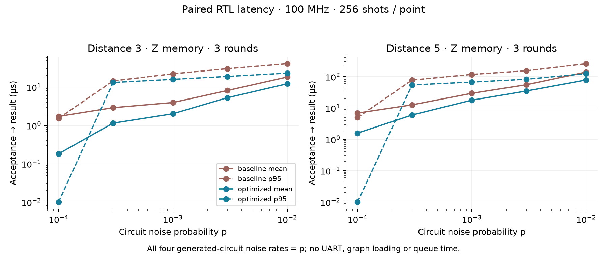
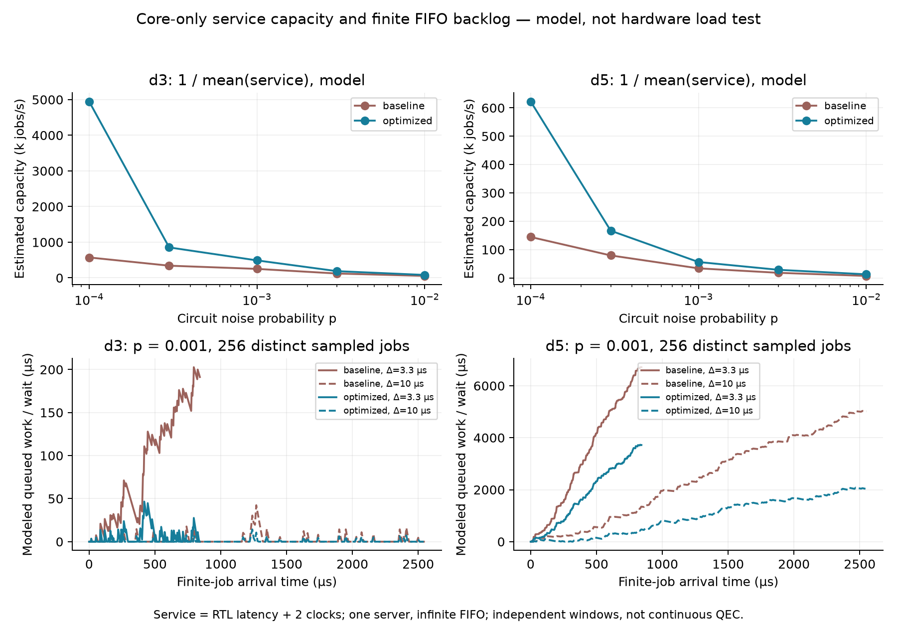
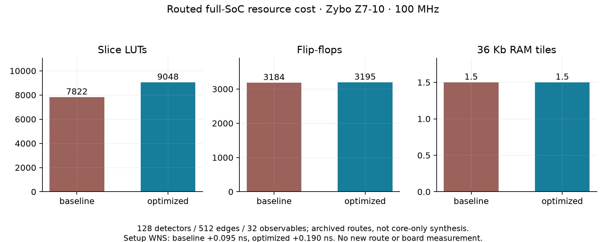

# RTL timing, modeled service capacity and routed resources

These figures compare the maintained optimized decoder with the archived pre-optimization core on identical, freshly sampled finite Z-memory jobs. Latency is RTL simulation; capacity and backlog are calculations from those measured cycles. Resources are from existing full-SoC routed reports. None is a new board measurement or a continuous-QEC demonstration.







## Workload and measurement

- Stim `surface_code:rotated_memory_z`, distances 3 and 5, **three extraction rounds throughout**; 256 shots at each of five noise points: `0.0001`, `0.0003`, `0.001`, `0.003`, `0.01`.
- All four generated-circuit noise arguments equal the plotted `p`: `after_clifford_depolarization`, `before_round_data_depolarization`, `before_measure_flip_probability`, and `after_reset_flip_probability`. This is circuit-level noise, not a phenomenological detector-flip model.
- Each circuit is archived verbatim. Stim 1.16.0 samples detectors and logical-observable truth in one batch of 256 with seed 123. The same seed across noise points does not imply independent datasets or same-fault pairing. Pairing here means **baseline and optimized receive exactly the same syndrome sequence** at each point.
- The maintained `qec.surface.graph.checked_graph` validates the decomposed detector error model and produces ordered unweighted edges. Graph topology and ordering are unchanged across these positive noise points: d3 has 24 detectors / 78 edges; d5 has 72 / 278. There is no per-noise decoder-weight optimization.
- `scripts/simulate.py --vectors ...` runs the maintained `fpga/rtl/tb/tb_decoder.sv` through Vivado 2025.2 `xvlog`, `xelab`, and `xsim`. Optimized RTL is `fpga/rtl/common/qec_decoder.sv`; baseline RTL is the archived core from study revision `de7f0b8`.
- The bench independently counts acceptance-to-result clock edges, compares them with the reported cycle field, checks each prediction/error against the maintained Python ordered-growth/peeling decoder, and records per-state cycles. The analysis verifies all 2,560 corpus shots per core, state-cycle totals and identical ordered merge/peel traces. The bench reports 2,565 checked shots because five additional protocol diagnostics are not included in the figures.
- Clock conversion is 100 MHz: one cycle is 0.01 µs. Means include empty syndromes. p95 is the nearest-rank statistic, index `ceil(0.95*n)-1` in sorted samples. With rare expensive nonempty shots, p95 can be **below the mean**; this is visible at the lowest noise point. These are finite empirical statistics, not worst-case bounds or confidence intervals.
- Sampling, syndrome packing/acquisition, graph upload, PS firmware, UART, host calls, queueing and stalled result retirement are excluded from the latency chart. RTL-reference agreement is a correctness check, not an accuracy claim against logical truth; use the separate accuracy benchmark for logical failure rates.

### Example: p = 0.001

| Workload | Core | Empty / shots | Mean latency (µs) | p95 latency (µs) | Modeled capacity (k jobs/s) |
|---|---|---:|---:|---:|---:|
| d3 Z, r3 | Baseline | 215 / 256 | 3.9565 | 22.27 | 251.48 |
| d3 Z, r3 | Optimized | 215 / 256 | 2.0206 | 15.97 | 490.05 |
| d5 Z, r3 | Baseline | 158 / 256 | 29.5158 | 117.75 | 33.86 |
| d5 Z, r3 | Optimized | 158 / 256 | 17.7691 | 67.05 | 56.21 |

## Service and backlog model

The maintained bench's separate unblocked handshake probe holds input valid and output ready high and checks consecutive acceptance edges. Both cores show the next acceptance gap equals the preceding result latency plus **two clocks**. This establishes the retirement/acceptance overhead for the probe, not implemented offered-load FIFO behavior for an external stream.

For the plots, one nonpreemptive server serves independent complete memory jobs with fixed graph residency, an infinite modeled FIFO, immediate result consumption and no transport or graph-reload cost:

```text
service[i] = measured_result_latency[i] + 2 clocks
estimated_capacity = 100,000,000 / mean(service) jobs/s
arrival[i] = i * arrival_interval
acceptance[i] = max(arrival[i], free_at)
wait[i] = acceptance[i] - arrival[i]
free_at = acceptance[i] + service[i]
```

The upper panels show an empirical sustainable-rate **estimate**, not measured hardware throughput. The lower panels use each of the 256 distinct sampled `p=0.001` jobs once, in sample order, with arrivals every 330 clocks (3.3 µs, approximately 303,030 jobs/s) and 1,000 clocks (10 µs, 100,000 jobs/s). They plot queued work as waiting time at each arrival, not queue length or wall-clock board data. The trace stops at the final arrival; remaining work subsequently drains. No sample sequence is repeated to manufacture a longer experiment.

For d3, optimization raises estimated capacity above the 3.3 µs offer rate, but burst waiting remains: maximum modeled wait falls from 202.68 to 46.58 µs. For d5, both offered rates exceed the estimated capacity even after optimization. Neither a mean-capacity estimate nor a finite trace proves backlog-free operation, deadlines, continuous-window decoding or adaptive feedforward. This workload comprises independent three-round experiments; it has no stitched detector history between jobs.

## Full-SoC resource cost

The source reports are the existing baseline and optimized `qec_soc_utilization.rpt`, `qec_soc_timing_summary.rpt` and `qec_soc_drc.rpt` under the core scan study's `evidence/{baseline,optimized}/`. The fresh optimized simulation core is byte-identical to the archived optimized routed core source. Reports are copied unchanged into this benchmark's evidence directory.

Both designs target `xc7z010clg400-1` at 100 MHz with capacity for 128 detectors, 512 edges and 32 observables. These are **full-SoC implementation totals**, not a per-distance resource scaling experiment or core-only synthesis estimates. Both archived routes meet their specified setup/hold constraints; this does not measure Fmax or board execution.

| Metric | Baseline | Optimized |
|---|---:|---:|
| Slice LUTs | 7,822 | 9,048 |
| Slice registers | 3,184 | 3,195 |
| 36 Kb RAM tiles | 1.5 | 1.5 |
| Setup WNS (ns) | +0.095 | +0.190 |
| Hold WHS (ns) | +0.038 | +0.042 |

No new route, bitstream load, firmware load, UART transaction or board programming was performed for this benchmark.

## Evidence and reproduction

Final raw evidence on the research workstation:

```text
/home/toastcheng/qc-research/fpga-qec/readme-benchmarks/timing/sweep-20261119-final/
```

This directory contains:

- `corpus.json`, ten `.stim` circuits, ten `*-shots.json` files and `vectors.txt`;
- `baseline/` and `optimized/`: fresh `simulation.log`, `profile.csv`, `trace.csv`, `initiation.csv`, modeled `queue-d*-p0.001-arrival*.csv` and copied route reports;
- `sources/`: exact maintained core, testbench, runner, graph/reference decoder and benchmark script; the baseline core is saved separately in `baseline/qec_decoder.sv`;
- `provenance.json`: tested Git revision/diff, exact simulator commands and private build directories, study origin and explicit no-programming status;
- `summary.json` and `SHA256.json`: chart aggregates and a content-hash manifest.

The original workflow and resource evidence remain at:

```text
/home/toastcheng/qc-research/fpga-qec/core-scan-study/{prepare,collect,analyze}.py
/home/toastcheng/qc-research/fpga-qec/core-scan-study/evidence/
```

The benchmark follows that workflow's vector format, instrumented bench, paired trace checks and latency-plus-two service boundary, while generating new noise-sweep shots rather than relabeling the old 384-shot corpus. Failed preliminary runs are retained separately as `sweep-20261119`, `sweep-20261119-v2`; successful development run `sweep-20261119-v3` is superseded by the final evidence above.

From the implementation repository, create a private Python environment and install `stim==1.16.0`, `pymatching==2.4.0`, `numpy==2.5.5`, and `matplotlib==3.11.2`. Vivado 2025.2's simulator and the original study evidence must be available. Use a **new** data path for every execution:

```sh
python3 -m venv build/readme-timing-venv
build/readme-timing-venv/bin/python -m pip install \
  stim==1.16.0 pymatching==2.4.0 numpy==2.5.5 matplotlib==3.11.2
PYTHONPYCACHEPREFIX=build/readme-timing-cache \
MPLCONFIGDIR=build/readme-timing-mpl \
build/readme-timing-venv/bin/python scripts/benchmark_timing.py run \
  --data /home/toastcheng/qc-research/fpga-qec/readme-benchmarks/timing/new-run \
  --study /home/toastcheng/qc-research/fpga-qec/core-scan-study \
  --vivado-bin /home/toastcheng/amd/2025.2/Vivado/bin \
  --shots 256 --seed 123
```

`run` executes both real RTL simulations, verifies their outputs, parses actual route reports and writes the three figures. Simulator directories are fresh UUID-named children of `build/sim/`. The successful author execution used a private `uv`-created Python 3.12 environment because the initially inspected interpreters lacked dependencies.

To recheck profiles and regenerate figures without rerunning RTL:

```sh
PYTHONPYCACHEPREFIX=build/readme-timing-cache \
MPLCONFIGDIR=build/readme-timing-mpl \
build/readme-timing-venv/bin/python scripts/benchmark_timing.py plot \
  --data /home/toastcheng/qc-research/fpga-qec/readme-benchmarks/timing/sweep-20261119-final
```

Use `--images <directory>` to render elsewhere. Regeneration uses existing actual samples and reports; it does not synthesize replacement measurements.
