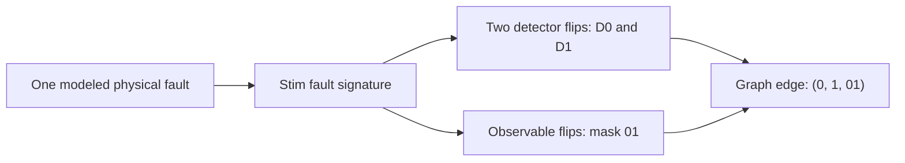
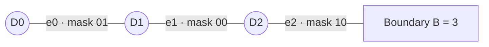
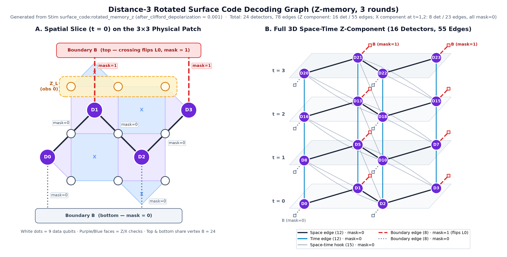
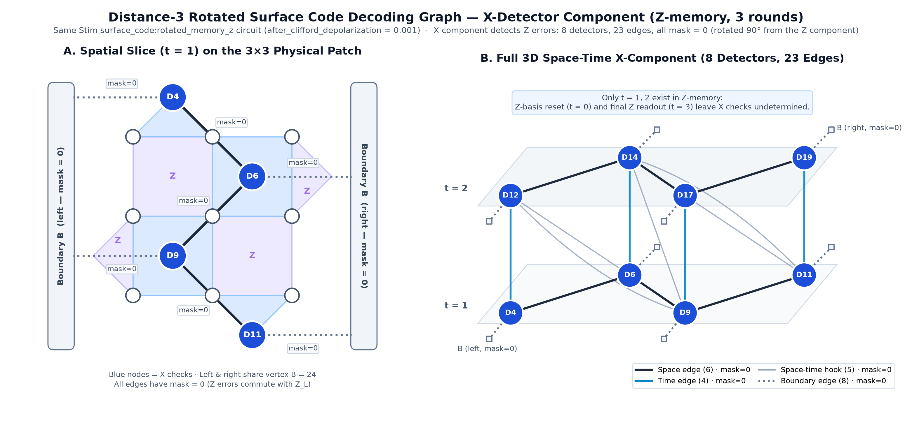
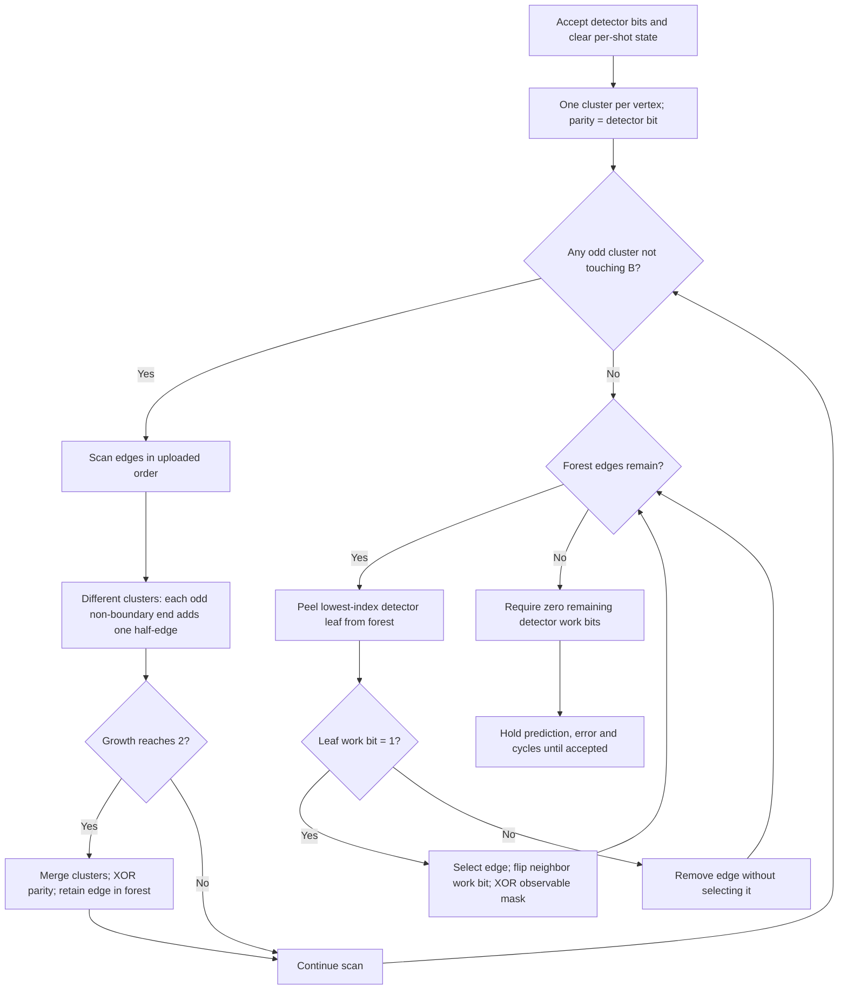
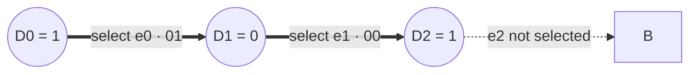

# Decoder design

The FPGA receives two things from the host: a circuit's decoding graph
(uploaded once per circuit) and a stream of syndrome bit vectors (one per
shot). On the Zybo Z7-10 at 100 MHz, the default runtime image holds up to
128 detectors, 512 edges, and 32 logical observable bits. Those limits count
decoding-graph objects rather than physical qubits.

See the [code walkthrough](code-walkthrough.md) for where each piece lives in
the source tree, and [verification](verification.md) for RTL, timing, and
board test results.

## From physical faults to a decoding graph

A **detector** is a parity check over measurement results that is always 0
when there is no noise — for example, comparing a stabilizer measurement with
the same stabilizer from the previous round. When a detector bit is 1 (a
"defect"), at least one error happened nearby. Each detector vertex represents
a specific check at a specific round, not a physical qubit.

When compiling a circuit, Stim tells us which detectors and logical
observables each single modeled fault flips. Every graph edge summarizes a
fault signature:

- **Internal edge `(a, b, mask)`**: flips detectors `a` and `b`, and flips the
  logical observables whose bits are set in `mask`.
- **Boundary edge `(a, B, mask)`**: flips only detector `a` (the fault touches
  the code boundary). The boundary has no measured bit of its own and is
  represented by a single special vertex `B = detector_count`.





In this three-detector example, `e0` flips observable 0 (`mask = 01`), `e2`
flips observable 1 (`mask = 10`), and `e1` flips neither (`mask = 00`). Note
that this is a decoding graph, not a physical qubit grid — edges can connect
checks across space or across consecutive rounds.

Two important properties of this graph:

- **Unweighted, ordered edges.** The FPGA does not store fault probabilities.
  When clusters tie during growth, edges uploaded earlier merge first, so the
  compiler preserves the exact edge order.
- **Signatures, not physical identities.** Different physical errors can flip
  the exact same pair of detectors and observables; the graph merges them into
  one edge.

To compile cleanly, an input circuit must have deterministic detectors and
observables when noise is disabled. The compiler rejects adaptive feedback,
hyperedges (single faults flipping three or more detectors), detectorless
logical flips, and conflicting observable masks on the same endpoints.
Zero-probability errors are ignored, so a noiseless circuit produces an empty
graph unless you pass an explicit compatible noisy reference circuit.

### Example: distance-3 rotated surface code

Compiling Stim's 3-round distance-3 rotated Z-memory circuit
(`surface_code:rotated_memory_z` with `after_clifford_depolarization = 0.001`)
produces 24 detectors and 78 edges split into two disconnected components
(ignoring the shared boundary vertex `B = 24`):



- **Z-detector component (16 detectors, 55 edges, first figure):** tracks X
  errors across four time slices (`t = 0..3`). Within each slice, internal
  edges cross the middle row of data qubits (`mask = 0`), while data qubits on
  the top and bottom boundaries touch only one Z check and therefore connect to
  `B`. Crossing the top row flips the logical observable `Z_L` (`mask = 1`);
  crossing the bottom row does not (`mask = 0`). Stacking rounds adds vertical
  time edges (measurement errors) and diagonal space-time edges (gate errors
  during syndrome extraction).



- **X-detector component (8 detectors, 23 edges, second figure):** tracks Z
  errors across the middle two slices (`t = 1, 2`) and is rotated 90 degrees
  from the Z graph, with boundary edges on the left and right. Z-basis reset
  and final Z readout leave X checks undetermined at `t = 0` and `t = 3`, and
  because Z errors commute with `Z_L`, every edge in this component has
  `mask = 0`.

## Decoding algorithm: grow clusters, then peel a forest

The core runs ordered, unweighted half-edge union-find growth followed by
forest peeling. The Python reference is [`decode`](../qec/surface/decoder.py),
and the hardware state machine is
[`qec_decoder`](../fpga/rtl/common/qec_decoder.sv).



### 1. Initialize

Each detector starts in its own cluster with parity equal to its syndrome bit.
The boundary vertex `B` starts in its own cluster and never initiates growth.
Edge growth counters, the merge forest, and the prediction mask all start at
zero.

**Zero-syndrome fast path:** if the graph is valid and all detector bits are
0, the core skips clearing the work arrays and returns prediction `0` after a
single counted clock. The next nonzero shot still initializes every active
entry before reading it, and width checks, aborts, and resets still apply.

### 2. Grow and merge

The core scans edges in their uploaded order:

1. Skip any edge whose two endpoints are already in the same cluster.
2. Otherwise, add 1 unit of growth for each endpoint whose cluster has odd
   parity and does not contain the boundary `B`. Growth caps at 2 (two
   half-edges meeting in the middle).
3. When an edge reaches growth 2, merge its two clusters and add that edge to
   the spanning forest. The merged parity is the XOR of the two cluster
   parities (two odd clusters cancel to even; an odd and an even cluster stay
   odd). If either cluster contains `B`, `B`'s root wins; otherwise the
   smaller root index wins, and all vertices with the losing label are updated.

Scans repeat until every odd detector cluster has either paired with another
odd cluster or connected to the boundary (a boundary cluster is allowed to
have odd parity). To guarantee termination in hardware, growth stops with a
decode error if it exceeds `2 * (detector_count + 1)` sweeps.

### 3. Peel the spanning forest

The merge forest spans the clusters, but it may include extra edges that are
not needed for the final correction. Peeling trims it down from the leaves:

1. Copy the original detector bits into working parity bits.
2. Pick the lowest-index detector vertex with forest degree 1 (the boundary
   vertex `B` is never picked as a leaf).
3. Look at the leaf's working bit:
   - If it is `1`, select its single forest edge, flip the neighbor's working
     bit, and XOR the edge's observable mask into the running prediction.
   - If it is `0`, discard the edge without changing the prediction.
4. Clear the leaf's working bit and remove the edge from the forest.
5. Repeat until no forest edges remain, then verify that every detector's
   working bit is `0`. Any leftover bit or missing leaf raises a decode error.

In RTL, the `FIND` scan checks edges serially and skips nonforest or already
peeled edges in a single clock cycle, only entering the registered
endpoint/work pipeline for active forest edges. See
[core performance](core-performance.md) for the measured speedup and resource
cost of that optimization.

### Worked example

Take the three-edge graph from above (`e0: D0-D1 mask 01`, `e1: D1-D2 mask 00`,
`e2: D2-B mask 10`) and suppose `D0` and `D2` fire, giving syndrome
`D2 D1 D0 = 101`:

1. **Sweep 1:** `D0` and `D2` are odd, `D1` is even. `e0` grows by 1 (from
   `D0`), `e1` grows by 1 (from `D2`), and `e2` grows by 1 (from `D2`). No
   edge reaches 2 yet.
2. **Sweep 2:** `e0` reaches 2 and merges `D0` with `D1` into an odd cluster.
   Next in order, `e1` reaches 2 and merges that odd cluster with odd `D2`
   into an even cluster. When the scan reaches `e2`, `D2`'s cluster is already
   even, so `e2` stops growing.
3. **Peeling:** The forest contains `e0` and `e1`. The lowest-index leaf is
   `D0` (work bit `1`), so peeling selects `e0` and moves the work bit to
   `D1`. Now `D1` is a leaf with work bit `1`, so peeling selects `e1` and
   cancels the work bit at `D2`.
4. **Result:** XORing the selected edge masks gives `01 XOR 00 = 01`,
   predicting a flip on observable 0.



If only `D2` fires (`100`), peeling instead selects `e2` to the boundary and
returns `10`. Both cases are tested directly against the Python decoder in
[test_design_examples.py](../qec/tests/test_design_examples.py).

Remember that the output is a logical observable prediction (Pauli-frame
update), not a physical gate sequence, and because this decoder is unweighted,
it can still mispredict when two different error chains produce the same
syndrome.

## Graph lifecycle and shot rules

- **Graph upload:** the host stages graph dimensions and edges in index order,
  then issues a commit. If any check fails, the graph stays invalid until a
  fresh begin command succeeds.
- **Busy protection:** writes while a decode is running or a result is still
  held are rejected with an error.
- **Abort vs. reset:** `shot_abort` cancels a shot while keeping the loaded
  graph intact; a full reset clears both the shot and the graph.
- **Syndrome words:** every active 16-bit syndrome word must be written before
  launching a decode, and any unused bits above the configured detector count
  must be zero.

## Partitioning larger graphs across windows

The host compiler accepts up to 1,024 detectors and 8,192 edges even though
one FPGA window holds 128 detectors and 512 edges. When a large graph splits
into separate connected components (ignoring the shared boundary vertex `B`,
which neither grows nor enforces parity), the host packs whole components into
hardware-sized windows.

Each window gets local detector indices while preserving edge order and global
observable masks. The host uploads and decodes each window on the same FPGA
image and XORs the returned predictions together. No detector-to-detector edge
is ever cut — if a single connected component exceeds hardware capacity, the
host rejects the circuit. Reported total cycles sum the individual FPGA core
runs and do not include graph uploads or UART transfer time.

## PS/PL mailbox register layout

The ARM firmware and PL bridge share two 32-bit AXI GPIO registers in a single
100 MHz clock domain (`FCLK_CLK0`). Only one command can be in flight at a
time. Bit ranges below are inclusive; box widths show field order rather than
proportional bit widths, and match the comments in
[ps_bridge.sv](../fpga/rtl/common/ps_bridge.sv).

### Control word (ARM writes, PL reads)

```text
 31    30          28 27          24 23             16 15                  0
+------+--------------+--------------+-----------------+---------------------+
| REQ  | reserved     | OPCODE       | INDEX           | DATA                |
+------+--------------+--------------+-----------------+---------------------+
  1 bit    3 bits          4 bits          8 bits              16 bits
```

To submit a command, ARM writes the fields while flipping bit 31 (`REQ`), then
keeps the word steady until `ACK` in the status register matches `REQ`.
Reserved bits should be written as 0.

- **Opcode 1:** write 16-bit staging register `INDEX` with `DATA`.
- **Opcode 2:** begin graph configuration (`INDEX = 0`).
- **Opcode 3:** append the currently staged edge (`INDEX = 0`).
- **Opcode 4:** commit graph configuration (`INDEX = 0`).
- **Opcode 5:** write 16-bit syndrome word `INDEX` with `DATA`.
- **Opcode 6:** launch decode (`INDEX = 0`).
- **Opcode 7:** read 16-bit metadata word `INDEX`.
- **Opcode 8:** abort the current shot (`INDEX = 0`).

Staging registers (`INDEX` for opcode 1) are separate 16-bit words: `0` =
detector count, `1` = edge count, `2` = observable count, `3` = edge index,
`4` = endpoint A, `5` = endpoint B, `6` = observable mask low 16 bits, `7` =
observable mask high 16 bits.

### Status word (PL writes, ARM reads)

```text
 31     30       29     28                         16 15                  0
+-------+--------+-------+----------------------------+---------------------+
| ACK   | DONE   | ERROR | reserved = 0               | READ_DATA           |
+-------+--------+-------+----------------------------+---------------------+
  1 bit   1 bit    1 bit           13 bits                   16 bits
```

- **ACK (bit 31):** echoes `REQ` once the bridge finishes the command. It
  tracks command phase, not success.
- **DONE (bit 30):** set when a decode result has been captured. Metadata
  reads leave it set; a new configuration begin, abort, or reset clears it.
  Because `DONE` can still reflect an earlier shot until a new decode
  finishes, software always checks `ACK` together with `DONE` and the graph
  identity.
- **ERROR (bit 29):** error flag for the *most recently acknowledged*
  operation. A subsequent metadata read can clear this bit even if the saved
  decode error is still set.
- **READ_DATA (bits 15:0):** returns the requested metadata word for opcode 7,
  and 0 for all other opcodes.

Metadata words (`INDEX` for opcode 7):

- `0`: protocol version (`2`)
- `1..3`: hardware limits — max detectors, max edges, max observables
- `4..6`: currently configured detectors, edges, observables
- `7`: configured-valid flag in bit 0 (bits 15:1 are 0)
- `8, 9`: 32-bit graph generation counter (low 16 bits, then high 16 bits);
  increments only on a successful commit
- `10, 11`: 32-bit predicted observable mask (low, high)
- `12, 13`: 32-bit core cycle count (low, high)
- `14`: saved decode error flag in bit 0 (bits 15:1 are 0)

```text
32-bit value reconstructed from two metadata words
 31                              16 15                              0
+----------------------------------+----------------------------------+
| HIGH: index 9 / 11 / 13           | LOW: index 8 / 10 / 12             |
+----------------------------------+----------------------------------+
           generation / prediction / cycles, respectively

Prediction mask (when 32 observables are configured)
 31                 2   1   0
+---------------------+---+---+
| observable 31 .. 2  | O1| O0|
+---------------------+---+---+
Each bit = predicted flip of that declared observable; unused bits = 0.

Syndrome write INDEX = w
 DATA[15]                                        DATA[0]
+------------------------------------------------------+
| D(16*w+15) ...                         ... D(16*w)    |
+------------------------------------------------------+
Bits beyond the configured detector count must be zero.
```

Both firmware and host require `DONE = 1`, a positive cycle count, and an
unchanged valid graph generation before accepting a decode. Checking `ACK`
alone isn't enough because a PL reset can leave `ACK = 0` looking like a
completed toggle-0 command. Also, because the mailbox allows only one
command at a time, abort cannot preempt an unacknowledged decode in flight.

## Serial framing and recovery

Host-to-ARM UART frames use magic byte `0xD4` for requests and `0x4D` for
replies. Serial opcodes are a separate namespace from the GPIO mailbox opcodes
above.

```text
Byte offset       0        1        2        3..4        5..(4+L)     (5+L)..(8+L)
              +--------+--------+--------+-----------+------------+---------------+
Request       | D4     | seq    | opcode | length L  | payload    | IEEE CRC32    |
Reply         | 4D     | seq    | status | length L  | payload    | IEEE CRC32    |
              +--------+--------+--------+-----------+------------+---------------+
Width           8 bits   8 bits   8 bits    16 bits      L bytes       32 bits
```

Length and IEEE CRC-32 are little-endian, and the CRC covers the 5-byte header
plus the `L`-byte payload (up to 512 bytes). Serial commands cover reading
identity, starting a graph load, appending edges (three `uint16` fields for
index and endpoints, plus a `uint32` observable mask), committing the graph,
decoding a syndrome, and aborting a shot. A decode reply carries `uint32`
prediction, `uint32` core cycles, and a 1-byte error flag.

If a transaction times out or arrives corrupted, the host blocks further
writes until `resynchronize()` consumes and validates the outstanding reply
(simply closing and reopening the serial port does not flush a late in-flight
reply), and then requires reloading the graph. Hardware failures always raise
an error rather than falling back to the Python decoder.

## Board LEDs

[`top_qec_soc.sv`](../fpga/rtl/top/top_qec_soc.sv) wires four bits of the
mailbox status register directly to the four Zybo user LEDs (active high, pin
assignments in [`top_qec_soc.xdc`](../fpga/constraints/top_qec_soc.xdc)):

```text
LED output       led[3]          led[2]          led[1]          led[0]
FPGA pin         D18             G14             M15             M14
Status bit       31              30              29              0
Meaning          ACK phase       decode DONE     operation ERROR READ_DATA bit 0
```

- **LED3 (`ACK`):** toggles every time a mailbox command completes.
- **LED2 (`DONE`):** stays lit after any finished decode (even if a decode
  error occurred) until a new graph begin, abort, or reset clears it.
- **LED1 (`ERROR`):** reflects the error flag of the latest mailbox operation,
  so a subsequent successful metadata read clears it even when the saved
  decode error bit is set.
- **LED0 (`READ_DATA[0]`):** shows bit 0 of the last read metadata register
  (typically metadata word 14, the saved decode error bit, at the end of a
  decode transaction).

All four LEDs are unstretched register outputs driven low on reset, so rapid
command bursts may flicker too fast to see. None of them tells you whether the
prediction matched Stim's true observable — that comparison always happens on
the host.
