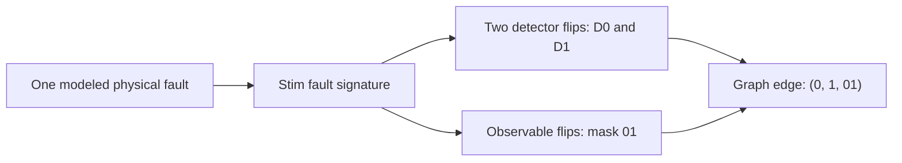
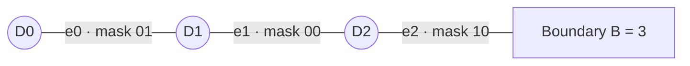
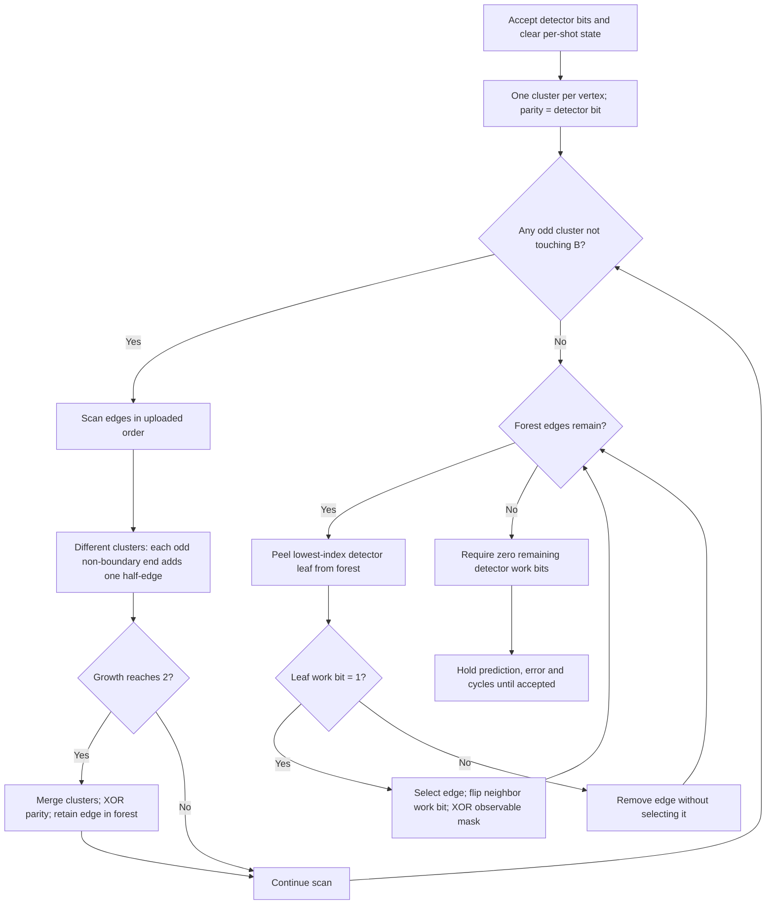
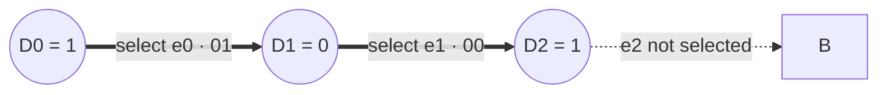

# Decoder design

The FPGA accepts a circuit-specific detector graph and one complete syndrome
window at a time. The Z7-10 image supports 128 detectors, 512 edges and 32
observable bits at 100 MHz. These limits count decoding objects, not physical
qubits. [Verification](verification.md) separates RTL, timing and board checks;
the [walkthrough](code-walkthrough.md) follows the implementation.

## From physical faults to a detector graph

A detector is a parity of measurement results that is predictable without noise.
For example, comparing a stabilizer measurement with the same check in the
previous round detects a change. A detector bit of 1 means that parity changed.
A detector vertex therefore identifies a check at a particular measurement
boundary, not a physical qubit.

The compiler asks Stim which detectors and declared observables each possible
fault flips. A graph edge represents a fault component that flips two detectors,
or one detector and a boundary. The boundary represents an unpaired endpoint;
it has no measured syndrome bit. The implementation uses one boundary vertex,
with index equal to the detector count.





This small graph has three detector vertices and one boundary. An edge contains
`(endpoint_a, endpoint_b, observable_mask)`. Mask bit i identifies a flip of
declared observable i. In this example e0 changes observable 0, e2 changes
observable 1, and e1 changes neither. The diagram is a decoding graph, not a
physical-qubit layout or a quantum circuit. Edges can connect different check
locations or different measurement boundaries.

The graph is unweighted: the FPGA does not use fault probabilities to choose
edges. The compiler preserves input edge order because that order breaks ties.
Multiple physical faults can have the same graph signature. The graph records
the signature; it does not identify which physical fault actually occurred.

Inputs must supply physical preparation, checks, detectors and observables.
Checks and observables must be deterministic without noise. The compiler rejects
unsupported feedback, non-graphlike fault components, detectorless logical
components and ambiguous endpoint/mask assignments. Zero-probability faults do
not create edges. An empty graph needs an explicit compatible noisy reference;
the compiler does not invent possible faults.

## Algorithm: grow clusters, then peel a forest

The core uses ordered, unweighted half-edge union-find growth followed by forest
peeling. The Python reference is
[`decode`](../qec/surface/decoder.py); the hardware state machine is
[`qec_decoder`](../fpga/rtl/common/qec_decoder.sv).



### 1. Initialize

Each detector starts in its own cluster. Its parity is its syndrome bit. The
boundary starts as a separate cluster and never drives growth. Per-edge growth,
the merge forest and the prediction mask start at zero.

A configured, width-valid zero syndrome returns zero prediction after one
counted clock, without scanning work arrays. A later nonzero shot initializes
every active entry before using it; reset, abort and graph validation are not
bypassed.

### 2. Grow and merge

Scan edges in their uploaded order. Ignore edges whose endpoints already belong
to the same cluster. For other edges, add one unit of growth for each endpoint
whose cluster has odd parity and does not contain the boundary. Growth saturates
at two units, representing two half-edges.

When growth reaches two, merge the clusters and retain that edge in the forest.
The new parity is the XOR of the old parities: two odd clusters become even;
one odd and one even remain odd. A boundary cluster wins a merge; otherwise the
smaller root index wins. Every vertex carrying the losing label is relabeled.
The RTL performs this scan serially, using registered memory-read stages.

Repeat scans until every odd detector cluster has paired with another odd cluster
or reached the boundary. Boundary clusters do not need even parity. The
implementation limits growth to `2 * (detector_count + 1)` sweeps and reports a
decode error if it cannot finish. This is a bounded implementation, not a claim
that every graph and syndrome has a solution.

### 3. Peel the merge forest

The merge forest contains candidate edges, not the final correction. Copy the
original detector bits into work bits. Repeatedly choose the lowest-index
detector vertex with forest degree one. The boundary is never chosen as a leaf.

If that leaf's work bit is 1, select its sole forest edge, flip the neighbor's
work bit and XOR the edge's observable mask into the prediction. If the leaf's
work bit is 0, do not select the edge. In either case, clear the leaf work bit
and remove the edge. When the forest is empty, all detector work bits must be
zero. Missing leaves or residual detector bits produce a decode error.

`FIND` still searches edges in order, but skips nonforest and removed edges in
one clock before reading endpoints/work through registered stages. See the
[measured core scan batch](core-performance.md) for paired nonempty timing,
resource costs and the distinction between arrival-rate screening and a
continuous-QEC claim.

### Worked shot

Use the three-edge graph above. Let D0 and D2 fire, so the detector bits are
`D2 D1 D0 = 101`.

1. First scan: e0, e1 and e2 each grow by one half-edge. Nothing merges yet.
2. Second scan: e0 fills and joins D0 to D1; this cluster is odd. e1 then joins
   that cluster to odd D2, making the combined cluster even. e2 does not grow
   further because its detector endpoint is now in an even cluster.
3. The forest contains e0 and e1. Peel D0: select e0 and move its work bit to
   D1. Peel D1: select e1 and cancel the work bit at D2.
4. The prediction is `01 XOR 00 = 01`. Observable 0 is predicted to have flipped.



If only D2 fires, peeling instead selects e2 to the boundary and returns `10`.
These examples are regression-tested against the actual Python decoder. Selected
edges explain the predicted observable frame; they are not instructions to apply
specific physical correction gates. Different physical faults can produce the
same syndrome, so a valid decode can still predict the wrong logical outcome.
This decoder is not weighted minimum-weight matching.

## Graph loading and shot lifetime

Configuration stages dimensions and sequential ordered edges, then commits only
after all declared edges pass validation. A malformed load stays invalid until
a new begin. Busy or held-result writes are rejected. Shot abort preserves the
committed graph; full reset clears it. Each shot must rewrite every active
syndrome word. Unused high syndrome bits must be zero.

## Disconnected components larger than one hardware window

The web and CLI host limits allow up to 1,024 detectors and 8,192 edges. The
FPGA still accepts only its advertised per-window capacity. When a larger graph
contains disconnected detector components, the host can pack whole components
into several windows and upload/decode them in sequence on the same image.
The common boundary does not connect components for this purpose: boundary
clusters never drive growth, and no boundary parity constraint is enforced.

Detector indices are remapped within each window. Edge order and global
observable-mask bits are preserved. The final prediction XORs the independently
returned masks. No detector-to-detector edge is cut; a single component that
exceeds capacity is rejected. The response records each window's detector map,
edges, syndrome, prediction and measured cycles. Reported total cycles sum these
core measurements and exclude graph uploads, UART and host work. Partitioning
does not make non-graphlike or correlated logical components representable.

## PS/PL mailbox register layout

ARM firmware and the PL bridge exchange 32-bit words through AXI GPIO in one
100 MHz FCLK domain. Only one toggle command may be outstanding. Bit ranges
below are inclusive; drawings show field order, not proportional field widths.
The same layouts appear beside the RTL declarations.

### Control word: ARM writes, PL reads

```text
 31    30          28 27          24 23             16 15                  0
+------+--------------+--------------+-----------------+---------------------+
| REQ  | reserved     | OPCODE       | INDEX           | DATA                |
+------+--------------+--------------+-----------------+---------------------+
  1 bit    3 bits          4 bits          8 bits              16 bits
```

ARM changes REQ to submit a command, then holds the word stable until ACK matches
REQ. Reserved bits should be written as zero; the bridge ignores them.

- Opcode 1: write staging word INDEX with DATA.
- Opcode 2: begin graph configuration; INDEX must be zero.
- Opcode 3: append the staged edge; INDEX must be zero.
- Opcode 4: commit graph configuration; INDEX must be zero.
- Opcode 5: write syndrome word INDEX with DATA.
- Opcode 6: launch decode; INDEX must be zero.
- Opcode 7: read metadata word INDEX.
- Opcode 8: abort a shot; INDEX must be zero.

Staging word indices are 0 = detector count, 1 = edge count, 2 = observable count,
3 = edge index, 4 = endpoint A, 5 = endpoint B, 6 = mask low half,
7 = mask high half. These are 16-bit words, not packed subfields of DATA.

### Status word: PL writes, ARM reads

```text
 31     30       29     28                         16 15                  0
+-------+--------+-------+----------------------------+---------------------+
| ACK   | DONE   | ERROR | reserved = 0               | READ_DATA           |
+-------+--------+-------+----------------------------+---------------------+
  1 bit   1 bit    1 bit           13 bits                   16 bits
```

ACK is the acknowledged request phase, not a success bit. DONE means a decode
result was captured. It survives metadata reads; acknowledged configuration begin,
abort or reset clears it. During a new decode, the status word can still describe
the previous acknowledgement until the new result arrives, so DONE is not a busy
indicator. Check the matching ACK and the returned graph identity as well. ERROR
reports the acknowledged operation's error; after a metadata read it does not
necessarily describe the previous decode. READ_DATA contains the requested
metadata for opcode 7 and is zero for other acknowledged operations.

Metadata indices 0–7 return protocol version (2), maximum detectors, maximum
edges, maximum observables, configured detector count, edge count, observable
count and configured-valid. In configured-valid, bit 0 is valid and bits 15:1
are zero. Indices 8/9, 10/11 and 12/13 return generation, prediction and cycles,
respectively, low 16-bit half first. Index 14 returns saved decode error in bit 0,
with bits 15:1 zero.

```text
32-bit value reconstructed from two metadata words
 31                              16 15                              0
+----------------------------------+----------------------------------+
| HIGH: index 9 / 11 / 13           | LOW: index 8 / 10 / 12             |
+----------------------------------+----------------------------------+
           generation / prediction / cycles, respectively

Prediction mask (when 32 observables are configured)
 31                 2   1   0
+---------------------+---+---+
| observable 31 .. 2  | O1| O0|
+---------------------+---+---+
Each bit = predicted flip of that declared observable; unused bits = 0.

Syndrome write INDEX = w
 DATA[15]                                        DATA[0]
+------------------------------------------------------+
| D(16*w+15) ...                         ... D(16*w)    |
+------------------------------------------------------+
Bits beyond the configured detector count must be zero.
```

Generation advances only on successful commit. Decode acceptance requires DONE,
positive cycles and unchanged valid graph identity. A matching ACK alone can
alias after reset. Abort cannot preempt an unacknowledged decode on this
one-outstanding-command mailbox.

## Serial framing and recovery

Requests start with `D4`, replies with `4D`. The serial opcodes are a separate
namespace from the GPIO mailbox opcodes above.

```text
Byte offset       0        1        2        3..4        5..(4+L)     (5+L)..(8+L)
              +--------+--------+--------+-----------+------------+---------------+
Request       | D4     | seq    | opcode | length L  | payload    | IEEE CRC32    |
Reply         | 4D     | seq    | status | length L  | payload    | IEEE CRC32    |
              +--------+--------+--------+-----------+------------+---------------+
Width           8 bits   8 bits   8 bits    16 bits      L bytes       32 bits
```

Length and CRC are little-endian. CRC covers the header and payload, not the CRC
itself. Maximum payload is 512 bytes. Serial operations read identity, begin a
graph load, append indexed edges, commit, decode and abort. An edge record has
three uint16 fields (index and endpoints) plus a uint32 observable mask. A decode
reply contains uint32 prediction, uint32 core cycles and one error byte. The host
verifies committed dimensions, validity and generation before submitting a shot.

After uncertain completion, the host blocks writes until bounded
resynchronization validates the outstanding reply, then requires graph reload.
Closing and reopening the port does not prove a delayed reply has disappeared.
FPGA failures never trigger a software fallback.

## Board LEDs

[`top_qec_soc.sv`](../fpga/rtl/top/top_qec_soc.sv) directly connects four status
bits to the user LEDs. A value of 1 drives the LED output high. Pin assignments
come from [`top_qec_soc.xdc`](../fpga/constraints/top_qec_soc.xdc).

```text
LED output       led[3]          led[2]          led[1]          led[0]
FPGA pin         D18             G14             M15             M14
Status bit       31              30              29              0
Meaning          ACK phase       decode DONE     operation ERROR READ_DATA bit 0
```

- LED3 changes phase as mailbox commands are acknowledged. It is not a heartbeat
  or an indication that a decode passed.
- LED2 stays high after a completed decode, including one with a decode error,
  until an operation clears DONE. It does not mean logical success.
- LED1 shows the most recently acknowledged operation's error. A later successful
  metadata read can clear it even if the saved decode error is still set.
- LED0 shows the low bit of the current status data, usually the most recently
  read metadata word. It is not permanently wired to prediction bit 0. The
  firmware's last metadata read is normally saved decode error, so LED0 can show
  that bit at the end of a transaction; rely on the returned API result instead.

These are latched register indicators, not stretched pulses. Fast command
activity may be invisible to the eye. Reset drives all four low. None of these
LEDs measures whether the predicted logical frame matches simulation truth;
that comparison happens on the host.

## Interpretation

Graph hashes identify host artifacts; the FPGA does not cryptographically attest
the uploaded graph. Observable truth remains on the host. Hardware predictions
are observable-frame decisions, not physical correction gates or a demonstrated
adaptive feedback loop. Physical annotations or a display-only logical circuit
do not establish an encoding or an automatic fault-tolerant compilation.
