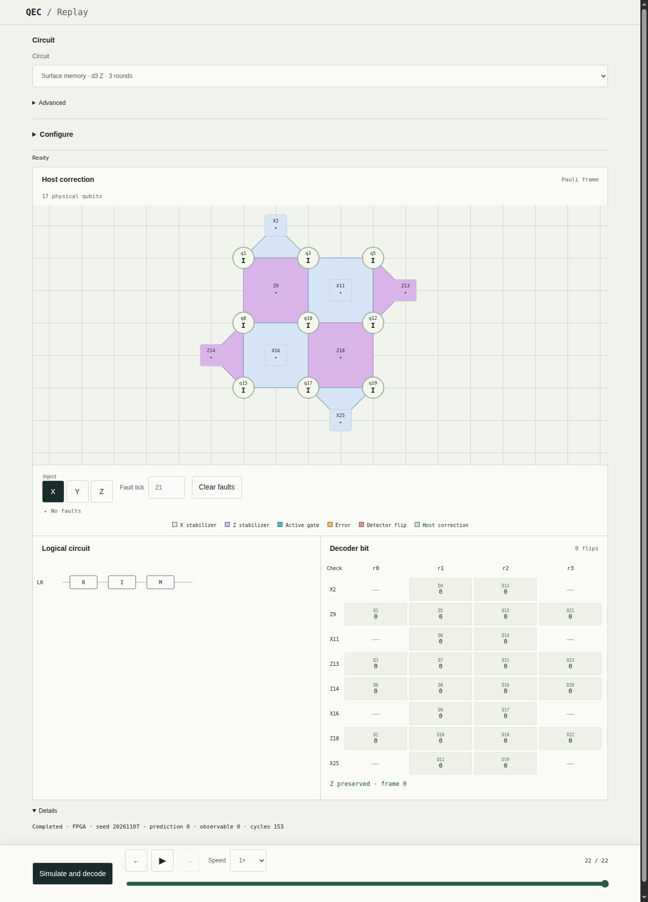

# Quick start

A standalone QEC decoder project for the **Digilent Zybo Z7-10**
(`xc7z010clg400-1`), with Stim-generated inputs, FPGA decoding, and host-side
verification.

## Prerequisites

### Python

Install [uv](https://docs.astral.sh/uv/getting-started/installation/), then run
these commands from the repository root:

```sh
uv venv --python 3.12 qec/.venv
uv pip install --python qec/.venv/bin/python -r qec/requirements.txt
source qec/.venv/bin/activate
mkdir -p build
```

### AMD toolchain and board

For FPGA decoding and optional RTL simulation, install Vivado/Vitis 2025.2 with
Zynq-7000 support using the [AMD installation guide](https://docs.amd.com/r/2025.2-English/ug1742-vitis-release-notes/Installing-the-Vitis-Software-Platform).
Add their bin directories to PATH, adjusting the installation paths below:

```sh
export PATH="$HOME/amd/2025.2/Vivado/bin:$HOME/amd/2025.2/Vitis/bin:$PATH"
```

Install the [Digilent board files](https://digilent.com/reference/programmable-logic/guides/install-board-files)
and AMD cable drivers for the Zybo Z7-10. The build uses board part
`digilentinc.com:zybo-z7-10:part0:1.2`. Set `QEC_BOARD_REPO` to the `board_files`
directory if it is outside Vivado's board search paths.

Connect the powered board through its PROG/UART USB port and grant your account
serial-device access.

## Quick start

### 1. Build the bitstream and firmware

```sh
make build IMAGE_DIR=build/image
make firmware IMAGE_DIR=build/image
```

The Makefile builds the current graph-loadable design under `fpga/`, then builds
ARM firmware against the exported XSA. With the directory above, outputs are:

- `build/image/qec_soc.bit`
- `build/image/qec_soc.xsa`
- `build/image/vitis_ws/qec_app/build/qec_app.elf`

### 2. Load the board

Close serial monitors and serial-backed web servers, then find the UART port:

```sh
python -m serial.tools.list_ports -v
PORT=/dev/ttyUSB1          # use the discovered UART port
make load IMAGE_DIR=build/image
```

`make load` loads the matching bitstream, ELF and XSA over JTAG. It programs
volatile PL state and restarts ARM core 0; it does not write boot flash.
The four user LEDs show mailbox ACK, decode-complete, operation error and
returned-data bit 0; none is a logical-success light. See the
[LED map](decoder-design.md#board-leds).

### 3. Open the web interface

```sh
python -m qec.surface.web --port 8765 --serial-port "$PORT"
```

Open **http://127.0.0.1:8765/**. After a completed run, open **Details** to check
that the decoder source is **FPGA**. For software-only use, omit
`--serial-port "$PORT"`, the decoding will be handled by the host's pymatching
implementation instead.

The server binds only to loopback. Opening the page does not query, program or
reset the board. No frontend build is needed. Stop it with Ctrl+C before using
the UART with another client.

### 4. Define the circuit

Choose **Surface memory**, **Encoded Bell**, or **Encoded echo** from the circuit
list. Open **Advanced** to edit the annotated Stim circuit for customization.
Under **Configure**, you can set the depolarization and random seed.

The physical view includes every used qubit. The injection controls are directly
below that layout. Select X/Y/Z and a fault tick, then click a physical qubit
to inject an error.

### 5. Simulate and decode

Click **Simulate and decode** in the bottom bar. The server compiles the submitted
experiment and samples one seeded Stim shot. In FPGA mode it reads the image's capacities,
uploads the circuit's exact ordered graph and decodes that shot's detector bits.
The FPGA returns an observable-flip mask and measured core cycles. Observable
truth stays on the host and is used to evaluate the returned prediction.

### 6. Replay the completed run

Use the bottom bar's play/pause and step buttons, or scrub the circuit tick.
The final tick shows prediction versus true observable mask; bit i means flip
the interpretation of logical observable i.



## Alternative: command-line workflow

Run an annotated circuit in software:

```sh
python -m qec.surface.run qec/examples/two_repetition_echo.stim --shots 128 --seed 123 --out build/my-software-run
```

```json
{
  "source": "Software",
  "shots": 128,
  "seed": 123,
  "qubits": 102,
  "detectors": 720,
  "observables": 6,
  "edges": 1716,
  "measurements": 774,
  "ticks": 114,
  "logical_failures": 0,
  "reference_mismatches": 0,
  "graph_sha256": "c92e45bee04d38a8561a3aded7f6cb1206aabeec70f3bd00b93ac243aabd49e6"
}
```

- `source`: actual decoder path, Software or FPGA.
- `shots`, `seed`: sampled batch size and random seed.
- `qubits`, `detectors`, `observables`, `edges`: physical index count and compiled
  decoding dimensions; qubits include gaps up to the highest index.
- `measurements`, `ticks`: measurement results and TICK separators, not measured
  hardware time or extraction rounds.
- `logical_failures`: predictions differing from actual Stim observable truth.
- `reference_mismatches`: returned predictions differing from the Python UF
  reference, or reference decode errors. This is separate from logical accuracy.
- `graph_sha256`: host artifact identity, not FPGA-attested cryptographic identity.

To use the loaded FPGA instead, close the web server and add the UART:

```sh
python -m qec.surface.run qec/examples/two_repetition_echo.stim --shots 128 --seed 123 --port "$PORT" --out build/my-fpga-run
```

The CLI uploads each hardware-sized graph window and archives actual predictions,
truth, core cycles and serial evidence. This echo uses six windows of disconnected
detector components; they are uploaded and decoded sequentially for each shot,
and their observable masks are XORed. Total cycles sum only the six measured
core decodes, excluding graph uploads and UART. Graph edges are never cut to fit.
`--out` must be new.
`--reference FILE` supplies an explicit compatible noisy reference. See the
[CLI walkthrough](code-walkthrough.md#follow-one-cli-run) for archive fields and failure
behavior. Equal seeds do not imply equal shots across the CLI batch sampler and
the web's single-shot FlipSimulator call sequence.


## Optional RTL check

```sh
make sim
```

With Vivado's simulator available, this checks core predictions, the mailbox
bridge, cycle counts and recovery. It is not required before running a board
example and does not establish physical-board operation.
