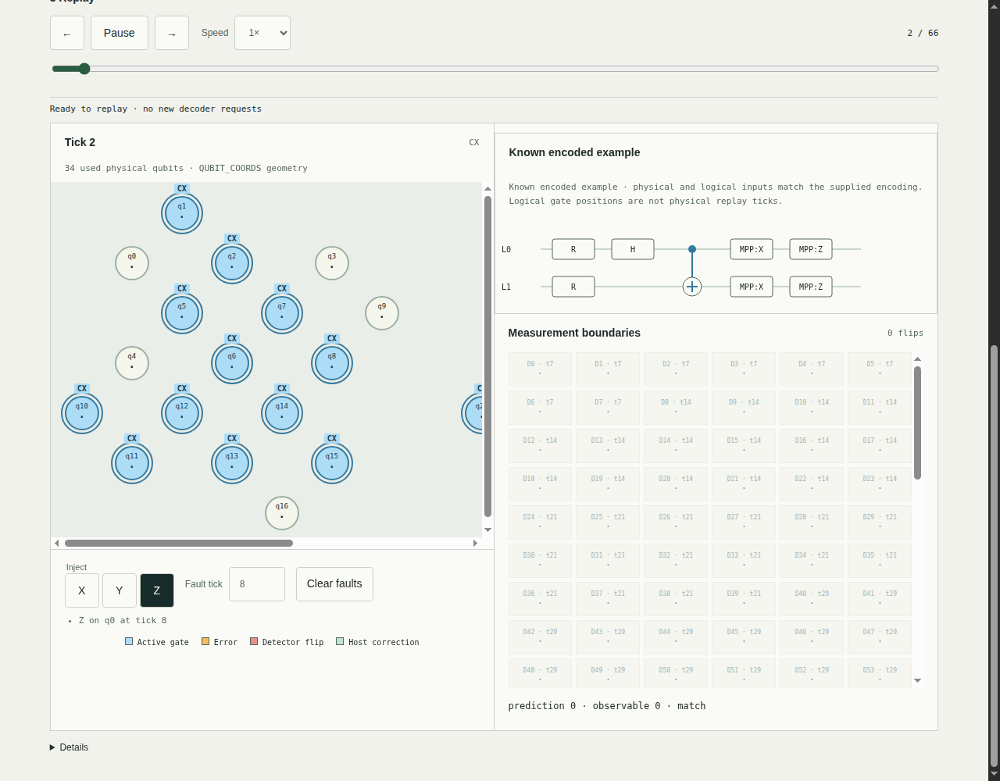

# Verification

The graph-loadable decoder accepts detector-annotated physical Clifford circuits and uploads their ordered decoding graphs without rebuilding the FPGA image. It does not synthesize logical programs into fault-tolerant circuits.

The historical results below belong to the archived, pre-reorganization image.
Their artifact names are evidence locators, not current build commands.

## Reorganized build and unified interface

The reorganized sources produced a matching `qec_soc.bit`, `qec_soc.xsa` and
`vitis_ws/qec_app/build/qec_app.elf` in `build/image-restructured/`.
The exported bitstream matched the bitstream inside the XSA, and imported
firmware sources matched `fpga/vitis/src/`. That bundle was loaded over volatile
JTAG, with no flash writes.

The unified interface at `python -m qec.surface.web` completed physical FPGA runs
for the memory preset (761 core cycles) and the six-qubit repetition example
(21 core cycles). The latter displayed all six physical qubits beside a supplied
two-wire logical diagram. Replay added no POST requests after `/api/circuit-run`.
A separate 128-shot six-qubit CLI run had zero reference mismatches and zero
logical failures in that finite batch. Build and board evidence is under
`build/verification/restructured/` on the build machine.

The browser suite passed 16 checks, including real API runs, edit invalidation,
local replay, 32-bit observable masks, a 1,024-qubit index grid and a 360px layout.
The [quick start screenshot](images/web-fpga-layout.png) shows the unified UI
with a real FPGA result. These checks are separate from the older six-graph
archive described below.

## Encoded examples and component windows

The default examples now contain real distance-3 rotated surface-code patches:
Bell uses 34 physical qubits, 144 detectors and 340 graph edges; the six-patch
echo uses 102 physical qubits, 720 detectors and 1,716 edges. Each patch uses nine
data qubits and eight reused extraction ancillas. The [example guide](../qec/examples/README.md)
states the semantic adaptations, nonlocal transversal-CX assumption and restricted
storage/readout noise model. These results do not verify faulty-gate protocols
or an arbitrary logical compiler.

Every distinct raw single-fault graph signature was checked against the actual
unweighted UF reference: 340 Bell cases and 1,716 echo cases, with no decode or
observable-mask mismatches. Exact raw signatures also match the compiled graph;
unsupported circuit-level correlations remain rejected. The software run with
128 shots and seed 42 had zero Bell logical failures and one echo logical failure.
Both had zero reference mismatches. The quick-start echo run at seed 123 had zero
logical failures in 128 shots. These are finite samples, not threshold estimates.

On the already loaded FPGA image, both examples completed eight-shot CLI batches
at seed 42 with zero logical failures and zero reference mismatches. Bell used
two exact disconnected-component windows per shot; echo used six. Independent
archive checks validated framing, lengths, CRC32, sequence, returned status and
mask/cycle recombination for all 169 Bell transactions (16 core decodes) and
625 echo transactions (48 core decodes). Raw evidence is under
`build/verification/encoded-examples/` on the build machine, including
`verification.json`, `wire-verified.json` and per-example shot/wire archives.
No board reprogramming or flash write was needed for these runs.

The physical-FPGA web path also completed both encoded examples, displaying
34 physical/two logical wires and 102 physical/six logical wires respectively.
Bell fault editing retained a listed Z injection on q0 at tick 8; its subsequent
Run matched the simulated observable. Replay added no POST requests. The echo
web run reported prediction 0, observable 0 and 11,551 summed core cycles over
six windows. Reported cycle sums exclude graph upload and UART time.

Software regressions passed 226 tests; the 18 browser checks include both
runnable encoded dropdown choices, local edits/replay, fault lists, 32-bit masks,
all-qubit scrolling and mobile layout. The tested default noise model is shown
beside the selected preset in the UI.

## Built image

Actual Vivado/Vitis 2025.2 artifacts are in `build/runtime-image-v2/` on the build machine:

- `runtime_soc.bit` and `runtime_soc.xsa`.
- `vitis_ws/runtime_app/build/runtime_app.elf`, linked against the matching XSA and real ARM BSP/xiltimer.
- `complete-bundle-verification.json`, pairing routed input-source hashes, bitstream/XSA hashes and firmware source/ELF hashes.

The XSA's embedded bitstream was compared byte-for-byte with the exported `.bit`. Imported firmware C/header files matched maintained sources byte-for-byte. The ELF is a 32-bit ARM EABI5 executable. These checks establish artifact pairing, not board execution.

The [archived manifest](../qec/surface/results/runtime-build-20261115-v2/manifest.json) hashes included raw reports, compiler-to-RTL logs and the exact hardware/firmware source snapshot. It explicitly lists the large binary artifacts as external, not included in Git. Original `verification.json` files retain build-machine-relative evidence locators; use the archive manifest for included files.

## Routed feasibility

Capacity is unchanged at 128 detectors, 512 edges and 32 observable bits on `xc7z010clg400-1`, with 100 MHz FCLK:

- Worst setup slack: +0.095 ns; zero failing setup endpoints.
- Worst hold slack: +0.038 ns; zero failing hold endpoints.
- 7,822 slice LUTs, 3,184 slice registers and three RAMB18 primitives.
- Zero routed DRC findings. Four LED outputs remain without output-delay constraints; internal endpoints are constrained.

The timing margin is positive but small. The Digilent PS preset also emits four negative DDR DQS-to-clock skew warnings; they were retained, not downgraded. This is not an independent DDR qualification.

The first unpipelined route failed setup by 3.479 ns. Registered growth/peeling stages removed the graph-RAM → label-RAM → union-selection → parity-write combinational chain. The successful image uses the same capacities and clock: no false-path or multicycle waiver, reduced frequency, or DRC downgrade was used. Original failed evidence remains in `build/runtime-image/` on the build machine.

## Simulation and software boundaries

Actual Vivado runtime benches reload graphs within one elaborated image and compare predictions with `qec.surface.decoder.decode`. Coverage includes 32-bit masks, malformed-load poisoning/recovery, held results, shot abort preserving the graph, full reset invalidation, high unused syndrome bits and independent cycle edges.

The generated core corpus contains 12 graphs and 474 checked shots. A separate compiler-to-core corpus loads five real Stim experiments, with 128 sampled shots per circuit: two-qubit phase-Bell verification, six-qubit repetition echoes, d3 Z/r3 memory, d3 X/r5 memory and d5 Z/r3 memory. Core answers match the Python UF reference. The d3 X/r5 sample had two logical failures against Stim truth; matching the implementation reference is not zero logical error. A separately labeled synthetic long-path diagnostic crosses the 16-bit cycle-report boundary naturally, measuring 287,940 cycles in the pipelined core.

Native C tests compile the actual firmware parser/GPIO adapter under ASan/UBSan. Host tests use real PTY byte streams, including delayed complete replies. Reset during a toggle-zero decode cannot become a successful zero result: firmware requires completion, positive cycles and consistent post-shot graph identity; the host independently checks cycles and identity. An uncertain stream is blocked until explicit bounded resynchronization validates the outstanding response, followed by graph reload. A one-outstanding-command mailbox does not provide preemptive abort of an unacknowledged decode.

Software/browser checks exercise the general editor, an unlisted Clifford composition, observable bit 31, actual sampled Pauli/detector traces, edit invalidation, initial zero-request behavior, local replay and mobile overflow. Software screenshots are labeled Software; no simulated transport result is presented as physical evidence.

## Current check entry points

Use `make test` for software checks and `make sim` for optional real RTL checks.
The [quick start](quickstart.md) gives current build/load commands; the
[walkthrough](code-walkthrough.md) maps the tests to implementation boundaries.
Rerun those checks after the refactor. Archived browser checks describe the
interface exercised at capture time, not acceptance of the newly unified UI.

## Physical-board execution

The matching runtime bitstream and ARM firmware were loaded over JTAG onto the Zybo Z7-10. Configuration readback showed DONE and INIT_B asserted and CRC error clear. No flash was written.

Six circuit graphs were uploaded and decoded without reprogramming between them: phase-Bell, two repetition echoes, an unlisted three-qubit Clifford circuit using observable bit 31, d3 Z/r3, d3 X/r5 and d5 Z/r3. Across 768 actual Stim shots and 251 diagnostic windows, all 1,019 FPGA predictions matched the Python UF reference; the sampled shots had zero logical failures in this finite corpus. This is not a zero-error-rate or threshold claim.

All 3,096 archived request/reply transactions were independently checked for framing, CRC and sequence. Seeded detector and observable truth was independently regenerated. Raw circuits, shots, wire frames, JTAG/program/configuration logs and the loaded artifact hashes are in the [physical archive](../qec/surface/results/runtime-board-20261115/manifest.json). Its `physical-verification.json` records the later board result; `loaded-bundle.json` preserves the earlier build-only provenance unchanged.

The runtime web interface was also exercised against the physical FPGA: explicit Run completed, the page reported FPGA cycles, and Replay made no additional API requests. Physical malformed-traffic/reset injection is not claimed by this capture; those cases have native/PTY/RTL regression evidence described above. The system still decodes completed simulated windows, not live adaptive quantum feedback.
